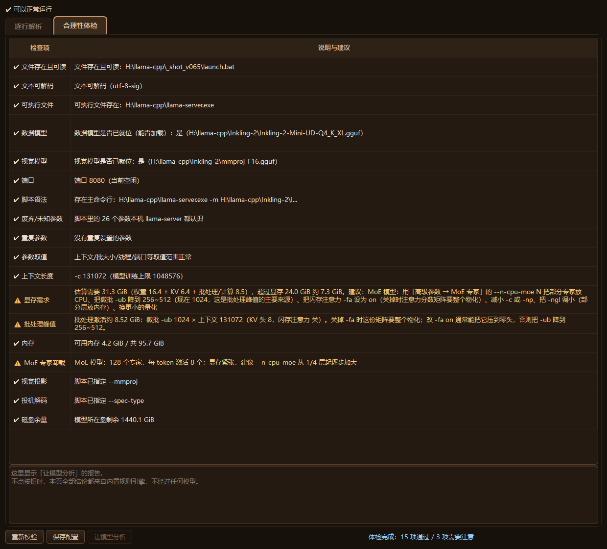

# LLama Launcher

[](https://github.com/lop008/llama-gui-launcher/releases/latest)
[](https://github.com/lop008/llama-gui-launcher/stargazers)
[](LICENSE)
[](#)
[](#)

A GUI launcher for llama.cpp local large language models. It turns the whole workflow — **pick a model → configure parameters → start the server in the background → monitor resources in real time → connect to Agent tools** — into a one-click experience. No more memorizing long command lines.

**[中文文档 / Chinese](README.zh-CN.md)**
> **Latest release: v0.6.5** — the launcher now adapts to llama.cpp's removal of `--mlock` instead of failing to launch, sanity-checks your launch scripts against the real machine (with an **opt-in** local-model report), scales the whole UI font, filters the llama.cpp updater by platform and backend, and turns MoE expert offloading into a **preset that is computed from your GPU and the model you picked**. See [Release Notes](RELEASE_NOTES.md) and [CHANGELOG](CHANGELOG.md).

## What's New in v0.6.5

1. **New llama.cpp builds keep launching** — llama.cpp 0.4.1 removed `--mlock` / `--no-mmap` in favour of `-lm/--load-mode`, so scripts that set those flags died with `error: invalid argument`. The launcher reads your `llama-server --help` (cached per executable, pre-warmed in the background) and writes the spelling **your build understands**: `-lm mmap+mlock` / `-lm none` / `-lm mlock` on new builds, legacy flags on old ones. `.bat` import understands `-lm` too.
2. **Launch-script sanity check** — *Tools → Launch file → Validate launch script* gained a **Sanity check** tab that works fully offline against this machine: removed/unknown flags, duplicates, out-of-range values (threads vs logical cores, `-ub` vs `-b`, port), context length vs the model's trained limit, and estimates for VRAM (weights + KV cache + compute cache), RAM and free disk. Missing metadata is reported as missing rather than guessed.
3. **"Ask the model" — only when you press it** — one button sends the health data (machine profile + model metadata + parameters, **API keys stripped**) to the llama-server **already running on your machine** and renders its report. No external service is ever contacted, the button is disabled while the service is stopped, and no model runs unless you click; if the request fails, the built-in conclusions above are still valid.
4. **Whole-UI font scaling** — `Ctrl` + mouse wheel, or `Ctrl` `+` / `-` / `0`, zooms the interface 80%–180% including fixed pixel metrics, so enlarged text still fits. Stored as `ui_scale` in `config.json`; the theme's factory sizes are never overwritten, so switching themes keeps your zoom and `Ctrl+0` returns to 100%.
5. **Updater filters that actually filter** — "Windows packages only" plus a multi-select backend list (CPU / CUDA / Vulkan / ROCm / SYCL / OpenVINO / OpenCL / zDNN) built from backends that really appear in the list. Same-dimension choices are OR-ed, different dimensions AND-ed, nothing selected means no limit. "Downloaded only" now means the file is actually on disk, other-platform packages are downloadable (install disabled, reason on hover), and a new button opens the official llama.cpp releases page.
6. **Speculative decoding greys out what your model can't use** — unsupported by your build, or neither the structure nor a usable draft, becomes un-selectable with the reason on hover, while "needs a draft" stays selectable and is marked `⚠`. A saved mode that doesn't fit the current model falls back to Auto and explains itself once in the status bar; the UI and the command line share one predicate so they cannot disagree.
7. **Vision projectors paired by precision** — F16 > BF16 > F32 > quantised (a stray F32 projector costs roughly twice the memory), with a hint when a projector file sits next to the model while the field is empty. Inkling 2 is confirmed a vision model: the vision tower lives in the external mmproj (`projection_dim=2304` matching the main model's `embedding_length`), so `has_clip=False` on the main weights is normal.
8. **Command preview became two draggable panes** — a per-flag "flag / what it means" table above the raw command line. It parses only the final command text, so the explanation always matches what actually runs; unlisted flags are labelled as unknown instead of invented.
9. **Tables and menus behave** — every column is draggable (auto-fill stops only when you resize the fill column itself), path columns elide in the middle so file names survive, the action column is measured from its buttons so nothing is clipped in any language, tabs have visible borders again, and the Tool menu is grouped into submenus.
10. **Crash hardening** — `QComboBox.setItemText()` used to fault when the window was rebuilt repeatedly, and background callbacks could reach a window being destroyed; both fixed (model-item text updates, a window-parented timer, `_closing`-guarded named slots, monitors stopped only on the real exit path).
11. **MoE offload presets** — pick a goal in the advanced MoE row (Auto / All in VRAM / Balanced / Save VRAM / Extreme / Long context) and the launcher computes `--n-cpu-moe N` and `--moe-cache-mib` from your machine's VRAM and RAM **plus the real per-layer expert size of the model you selected**, then prints the arithmetic below it so you can verify it. There is deliberately no static "VRAM tier × RAM tier" option table: the same 24 GiB card wants N=0 for Inkling 2 (14.7 GiB of experts) and `--cpu-moe` for Flash-Next (71.7 GiB). Because `--n-cpu-moe` offloads the *first* N layers while dynamic quantisation makes upper layers up to twice as heavy per layer (Inkling 2: 547 MiB × 21, then 1033 MiB × 3), the fit is searched top-down instead of dividing by a layer count. Editing anything by hand returns the chooser to "manual", switching model or context length recomputes, and unreadable information is reported as unreadable rather than turned into an invented N.
12. **Expert flags now reach only models that have experts** — configuration survives a model switch, so after running a MoE model with "first N layers on CPU", launching the dense Qwen3.8-27B still passed `--n-cpu-moe`. The three flags are gated on expert weights measured from the GGUF tensor table (multi-shard models summed shard by shard), and the whole MoE group is greyed out on dense models with the reason — while keeping your settings for when you switch back. A related crash was fixed too: models that store `attention.head_count` as a per-layer array (Inkling 2 writes 24 entries) broke the sanity check with a `TypeError`.
13. **Predict tokens and batch size became type-or-choose dropdowns** — common steps listed (`-1 = unlimited output`, 1024…65536; 256…8192), any number accepted, clamped to the legal range. The run-log tab got **Clear** and **Open log folder** buttons (clearing only affects the display; the per-day log files on disk are untouched) and now keeps at most 5000 lines in memory. The command-preview breakdown table finally fills the window width — the auto-fill used to run before `resizeEvent` and measure the previous viewport, which left a blank strip on the right of a maximized window.
14. **Micro-batch (`-ub`) and a pre-launch VRAM budget** — the launcher used to never send `-ub`, although it is what decides how many tokens actually enter the GPU at once; it now has its own field. Pressing *Start* estimates weights + KV + batch activation buffer against the VRAM that is genuinely free, and when the estimate doesn't fit you get the numbers plus "apply suggested micro-batch and start" / "start anyway" / "cancel" — no silent rewriting, no dialog when VRAM can't be read. The batch term comes from 15 measurements of llama-server's own buffer sizes (max deviation 3.7%, biased conservative).
15. **Self-update hardened** — *About → Check for launcher updates* (plus a silent check 6 s after start: title badge only, no popup). The swap script used to be three `move` commands with no error checking, so an antivirus eating the freshly downloaded unsigned exe would rename your working exe to `.bak` and then start a file that isn't there — reproduced locally. Every step is checked now, failures roll back automatically, nothing is started that may not exist, and the reason is shown in the status bar on the next launch. Downloads must match the size GitHub reports and pass a header check, `.part` resumes refuse to splice two releases together, and free space is checked up front. The launcher also knows whether it is a single-file or a folder (`exe` + `_internal`) install: portable builds now upgrade from `-portable.zip`, replacing dependencies while leaving `config.json`, logs and stats untouched.
16. **7 languages, fully in step** — 259 strings from all four feedback rounds translated into zh-TW / en / ja / ko / ru / es / fr and 19 obsolete strings removed: every table holds 1199 entries with 0 missing and 0 unused.

## What Problem Does It Solve?

Running local LLMs with llama.cpp usually means dealing with:

- **Complex command lines**: `llama-server.exe -m model -ngl all -c 32768 -n 8192 -fa on ...` — a long list of flags you have to remember
- **Messy model management**: model files scattered across folders, plus vision projectors (mmproj) and half-downloaded files to keep track of
- **Hard-to-control background server**: a console window flashes by, VRAM is not released after a crash, and a runaway/looping model is hard to stop
- **Vision model mismatches**: loading fails when the main model and its mmproj have different embedding dimensions
- **Trouble connecting Agent tools**: opencode, Claude Code, etc. need manual baseURL / API Key setup

This launcher automates and visualizes all of the above: **auto model scanning, visual parameter tuning, hidden-window background startup, real-time resource monitoring, one-click stop, and auto-connection for Agent tools**.

---

## Features

### Model Management
- **Auto scan**: recursively scans all `.gguf` files under the llama directory, skipping incomplete downloads (e.g. `.xltd`)
- **Model list sorting**: by directory + filename ascending (natural sort, default), size descending, or name only
- **Vision model pairing by directory**: after picking a main model, **only mmproj files in the same folder** are listed; auto-selects the matching one with **embedding-dimension consistency checks** — red warning + pre-start interception on mismatch
- **Model info**: reads the GGUF header offline (architecture / context length / quantization / parameter count) and now shows license, quantizer, base model, block count, embedding / feed-forward size, attention heads + GQA, head dims, RoPE base, MTP/NextN layers, SSM state, vocab size, tensor count, GGUF version, description and model URL — supports Unsloth dynamic quantization (`UD-*`, `Q4_K_XL`, …) and skips giant arrays for fast parsing

### Parameter Configuration
- **Basic**: listen address, port, context presets (one-click VRAM-based recommendation from 16K to 512K), GPU layers, context length, max prediction tokens
- **Advanced**: CPU threads, batch size, parallel slots, flash attention, **KV cache K / V independent types** (`-ctk` / `-ctv`, e.g. K=q8_0 + V=f16), continuous batching, temperature / top-p / top-k / repeat penalty, sampling presets (Precise / Balanced / Creative), API key, timeout, mlock, mmap, auto-open browser
- **Multi-GPU panel**: detect devices via `llama-server --list-devices`; check 1 card = pin to it, ≥2 cards = split with `-sm` mode / `-ts` tensor-split weights / `-mg` main GPU index
- **MTP (multi-token prediction)**: auto-detects MTP tensors in the selected GGUF (shard-aware; recognizes `mtp` / `nextn` / `next_n` / `eh_proj` / `shared_head` tensors and `nextn_predict_layers` metadata); when present you can enable `--spec-type draft-mtp` speculative decoding for faster generation
- **Context preset ↔ context length link**: picking a preset writes the context value; editing the context value auto-highlights the matching preset (or "Custom")
- **Every parameter has a hover tooltip**; full explanations are in `参数说明.md` (menu: About → Parameter Guide)

### Server & Monitoring
- **Hidden-window background startup**: opens the browser Web UI automatically once `/health` is ready
- **One-click stop**: `taskkill /T` kills the whole process tree (a lifesaver when the model runs away / loops)
- **Crash-proof, VRAM auto-release**: the server process runs inside a Windows Job Object (`KILL_ON_JOB_CLOSE`) — if this app crashes or is force-killed, the system cleans up the llama-server process tree and frees VRAM immediately
- **Real-time status bar**: CPU, memory, VRAM (nvidia-smi), **GPU core utilization**, running model, API activity and **live output speed (tok/s)**
- **Tray hover pill**: when minimized to the tray, a small always-on-top capsule shows a status dot + live tok/s + API dot; hover/click expands a card with speed, CPU, memory, GPU load, VRAM, API busy slots and model name. Drag to move (position remembered), double-click to restore, right-click menu to open/start/stop/hide/quit

### Network & Security
- **HTTPS**: one-click self-signed certificate generated into `certs/` (via `cryptography`, lazy-loaded); `--ssl-key-file` / `--ssl-cert-file` are applied to the server, health checks, browser URLs and opencode config (`https` scheme, local verification skipped for the self-signed cert)
- **LAN sharing**: one toggle sets host `0.0.0.0` and displays the reachable `http(s)://<local-ip>:<port>` address for other devices on the network
- **Online model query toggle**: auto-fetch HuggingFace details when a model is selected (can be disabled to stay offline)

### Agent Tools
- 4 built-in tools: **opencode** (auto-generates `opencode.json` pointing at the service), **OpenCode desktop** (copies connection info to clipboard), **Claude Code** (launch only, not auto-connected), **llama-server**
- "Open Agent Tool" opens the currently highlighted tool; **the last-selected tool is remembered and highlighted** on next launch
- Opening a tool auto-connects it to the running service; if the service is not running it still opens with a hint

### Model Download & llama.cpp Updates
- **Model download tab** (huggingface.co/unsloth): **two-column layout** (repositories on the left, files inside the selected repo on the right); **three-field search** (A organization/author · B model name/version · C auxiliary keyword) with AND/OR matching; sort by downloads / likes / name / recency; **per-row file table** (name / size / installed / download / progress) with header-click sorting and **resumable per-file downloads** (HTTP Range + `.part`); "Load more" + per-page count; repository info + operation log with a draggable splitter; and a **custom download directory** (defaults to the main page's model directory, one subfolder per repo)
- **Update llama.cpp tab**: pick any GitHub **Release version** (or type a tag) → download the Windows x64 prebuilt zip → **safe install** that only overwrites same-named files in the target dir with automatic `.bak` backups — models, configs and everything else are never touched. Or switch to **branch source mode**: pick any branch (e.g. `main`) and its source zip is downloaded (resumable) into a dedicated `llama.cpp-<branch>` subdirectory of your chosen folder
- **Export command preview as .bat** (Tools menu): save the exact "Command Preview" line to a `.bat` file at any path you choose; also "Export one-click launch (.bat)" with a desktop shortcut

### Usage Statistics (independent window, Tools → Data Statistics, or the 9th main-page button)
- Per model: open count, usage time, input / output tokens (parsed from llama-server log lines `prompt eval time` / `eval time`)
- Time breakdown by **hour / day / month**, scope filter all / today / last week / this calendar month; CSV export

### Other
- **Remembers last-used parameters** in `config.json`
- **Export / Import config**: `.aic` files (JSON content) for full backup/restore
- **Online model lookup**: queries HuggingFace for the model's intro / downloads / likes (7-day cache, falls back to local info offline)
- **Tray minimize**: closing the window minimizes to the system tray; tray menu shows / opens the hover pill / starts / stops / quits
- **Reorderable tabs**: drag the bottom tabs to reorder; the order is saved to `config.json` and restored next launch
- **Log files**: `logs/运行日志-YYYYMMDD.log`, one file per day
- **Six color themes** (Dark / Light / Orange / Green / Gray / Brown): pick from the "🎨 Theme" menu at the bottom-right of the status bar; switching never changes the layout size
- **Customizable icon / ad slot**: put `assets/icon.ico` to change the app icon; `assets/ad.png` fills the 430×40 ad slot at the bottom

---

## Installation

### Option A: Run from source (development / personal use)

**Requirements**
- Windows
- Python 3.9+ (verified on 3.13)
- llama.cpp's `llama-server.exe` and its DLLs (extract from llama.cpp Releases) inside the directory

**Steps**
```bat
cd /d your-launcher-directory
pip install -r requirements.txt
python main.py
```

Dependencies (`requirements.txt`): `PyQt6`, `requests`, `psutil`, `cryptography`

### Option B: Run the packaged exe (no Python required)

Download from the [Releases](https://github.com/lop008/llama-gui-launcher/releases) page:

| File | Description |
|------|-------------|
| `LLama-Launcher-v0.6.5-win-x64.exe` | **Single-file** build (x64, ~47 MB) — just double-click. First launch is slower (it unpacks to a temp dir, a few seconds); some antivirus may flag single-file executables — add an exception if needed. |
| `LLama-Launcher-v0.6.5-win-x64-portable.zip` | **Portable** build (x64) — extract and run `LLama启动器-win-x64-portable.exe`; starts faster, no self-extraction. |
| `LLama-Launcher-v0.6.5-win-arm64.exe` | **Single-file** build (ARM64) — for Snapdragon laptops / Windows on ARM. |
| `LLama-Launcher-v0.6.5-win-arm64-portable.zip` | **Portable** build (ARM64) — extract and run. |
| `Arm64.bat` | **One-click launcher for ARM64** — put it next to the exe and double-click; it always picks the arm64 build even if an x64 exe sits in the same folder (`一键启动.bat` is the x64 counterpart and prefers x64). |

Put `llama-server.exe` and its DLLs in the same directory (or set the launcher path in the UI).

---

## Usage

### Quick Start
1. **Set the llama directory**: select the folder containing `llama-server.exe`, click "Refresh Models"
2. **Pick a model**: select the main model; the vision model is auto-paired by directory (a red warning appears on dimension mismatch — switch it or choose "None" to run text-only)
3. **Tune parameters**: default port 8080, listen address `127.0.0.1`; use "Context Preset" for a VRAM-based recommendation; expand "Advanced" as needed
4. **Start**: click "Start Server" → runs in the background without a console window → the browser opens the Web UI at `http://127.0.0.1:8080/` when ready
5. **Monitor**: the status bar shows CPU / memory / VRAM / running model / API activity in real time
6. **Stop**: click "Stop Server" to terminate everything instantly when the model runs away or loops
7. **Connect Agents**: go to the "Agent Tools" tab, select a tool, click "Open Agent Tool" (auto-connects when the service is running)

### Menu Reference
| Menu | Items |
|------|-------|
| Start | Start Server / Stop Server / Exit |
| Tools | Refresh Models / Open Model Directory ｜ Open Web UI / View API Model List ｜ Open Agent Tool ｜ Export Config (.aic) / Import Config (.aic) / Export One-Click Launch (.bat) / **Export Command Preview (.bat)… (choose save path)** / **Data Statistics… (independent window)** ｜ Clear Log / Open Log Directory |
| About | Parameter Guide / Developer Info |

---

## Input / Output Examples

### 1. Generated startup command

After clicking "Start Server", the "Command Preview" and log show the **actual command executed**. For example:

```
llama-server.exe -m <your-model-path>
  --mmproj <your-mmproj-path>
  -ngl all -c 32768 -n 8192 -fa on --cont-batching
  --host 127.0.0.1 --port 8080
  -b 2048 -ctk f16 -ctv f16
  --temp 0.80 --top-k 40 --top-p 0.95 --repeat-penalty 1.00
  --timeout 3600 -a gemma-4-31B-it-Q6_K
```

### 2. Startup log (in the "Logs" tab)

```
[防护] Job Object enabled: llama-server will be auto-cleaned if this app exits/crashes, VRAM released immediately
common_params_print_info: verbosity = 3
srv  load_model: loading model '<your-model-path>'
Server ready: http://127.0.0.1:8080
```

### 3. Browser / API endpoints

- Web chat UI: `http://127.0.0.1:8080/`
- OpenAI-compatible API: `http://127.0.0.1:8080/v1`

Test with curl:

```
curl http://127.0.0.1:8080/v1/chat/completions ^
  -H "Content-Type: application/json" ^
  -d "{\"model\":\"gemma-4-31B-it-Q6_K\",\"messages\":[{\"role\":\"user\",\"content\":\"Hello\"}],\"max_tokens\":64}"
```

Response (abridged):

```json
{
  "id": "chatcmpl-...",
  "object": "chat.completion",
  "model": "gemma-4-31B-it-Q6_K",
  "choices": [{ "message": { "role": "assistant", "content": "Hello! Nice to meet you..." } }]
}
```

### 4. Agent auto-connection

When the service is running, opening opencode automatically writes `opencode.json` into the llama directory (backing up and merging any existing config):

```json
{
  "$schema": "https://opencode.ai/config.json",
  "provider": {
    "llama.cpp": {
      "npm": "@ai-sdk/openai-compatible",
      "name": "llama-server (local :8080)",
      "options": { "baseURL": "http://127.0.0.1:8080/v1" },
      "models": { "gemma-4-31B-it-Q6_K": { "name": "gemma-4-31B-it-Q6_K" } }
    }
  }
}
```

### 5. Config export

"Tools → Export Config" produces `xxx.aic` (JSON content, same structure as `config.json`) that can be restored on another machine with "Import Config".

---

## Directory Structure

```
LLama启动器/
├── main.py                # Entry point
├── requirements.txt       # Dependencies
├── 参数说明.md             # Full parameter documentation (in-app)
├── .gitignore
├── config.json            # Runtime config (auto-generated, contains API key - DO NOT upload)
├── hf_model_cache.json    # HF lookup cache (auto-generated)
├── logs/                  # Runtime logs (auto-generated)
├── assets/
│   ├── icon.ico           # App icon (optional, put here to apply)
│   ├── ad.png             # Bottom ad slot 430×40 (optional)
│   └── donate_qr.jpg      # Donation QR code in About dialog (optional)
├── docs/
│   ├── cover-vX.Y.Z.png   # Release cover image (one per release: brand banner, no download link)
│   ├── release_body_vX.Y.Z.md   # the exact text posted to the GitHub Release
│   ├── fix_report_vX.Y.Z.md     # per-feedback changelog (what / why / how verified)
│   └── screenshots/       # UI screenshots used by README / Release (2 per release + archive)
├── certs/                 # Self-signed HTTPS key/cert (auto-generated, DO NOT upload)
├── dist/                  # Packaged executables (pyinstaller, not in repo)
└── src/
    ├── main_window.py       # Main window + menu + tray + status bar
    ├── config.py            # Config read/write
    ├── themes.py            # Six color palettes (Dark/Light/Orange/Green/Gray/Brown)
    ├── model_scanner.py     # Model scanning / sorting / mmproj pairing
    ├── gguf_reader.py       # GGUF header parsing + MTP tensor detection
    ├── cmd_builder.py       # Command-line generation (KV K/V, multi-GPU, MTP, HTTPS)
    ├── server.py            # Subprocess / health check / stop / job object
    ├── jobobject.py         # Windows Job Object (auto-cleanup on crash)
    ├── system_monitor.py    # CPU/memory/VRAM/GPU/API/speed monitoring
    ├── net_utils.py         # Local-IP discovery + self-signed certificate generation
    ├── pill.py              # Tray hover pill (capsule + expandable stats card)
    ├── hf_info.py           # HuggingFace model lookup
    ├── hf_browse.py         # HF repo search / file listing (download tab backend)
    ├── hf_download_tab.py   # Model download UI (two-column, three-field search, per-row resume)
    ├── model_downloader.py  # Resumable HTTP downloader (.part + Range)
    ├── llama_updater.py     # llama.cpp releases/branches fetch + safe install
    ├── updater_tab.py       # Update llama.cpp UI (version / branch source)
    ├── usage_stats.py       # Usage stats store (opens/time/tokens, h/d/m buckets)
    ├── stats_dialog.py      # Independent model statistics window
    ├── bat_validator.py     # Static .bat/.cmd/.ps1 launch-script validator
    ├── presets.py           # Context presets / sampling presets
    ├── tools.py             # Agent tool registry & detection
    ├── opencode_launcher.py # Generates opencode.json
    └── about_dialog.py      # Developer info
```

## Screenshots

Two screenshots, one per main idea — the launcher itself and the v0.6.5 launch sanity check:

| | |
|---|---|
|  |  |
| Main window: model list, parameters, service status | Tools → Launch file → **Sanity check**: VRAM budget (weights + KV + batch activation buffer) with a one-click tune-down |

Older screens (`advanced.png`, `download.png`, `updater.png`, `agent.png`, `preview.png`, …) stay in `docs/screenshots/` as the archive referenced by earlier release notes.

## Developer Info

- Developer: AI创客师 / AIMakerLab
- Bilibili link in "About → Developer Info" (clickable)
- To change: edit the constants at the top of `src/about_dialog.py`

## Roadmap

- [x] Model download channel (HuggingFace, default org `unsloth`; resumable queue + save-dir picker)
- [x] llama.cpp in-app updates (Release versions with safe install; branch source zip download)
- [ ] Model lookup via ModelScope source
