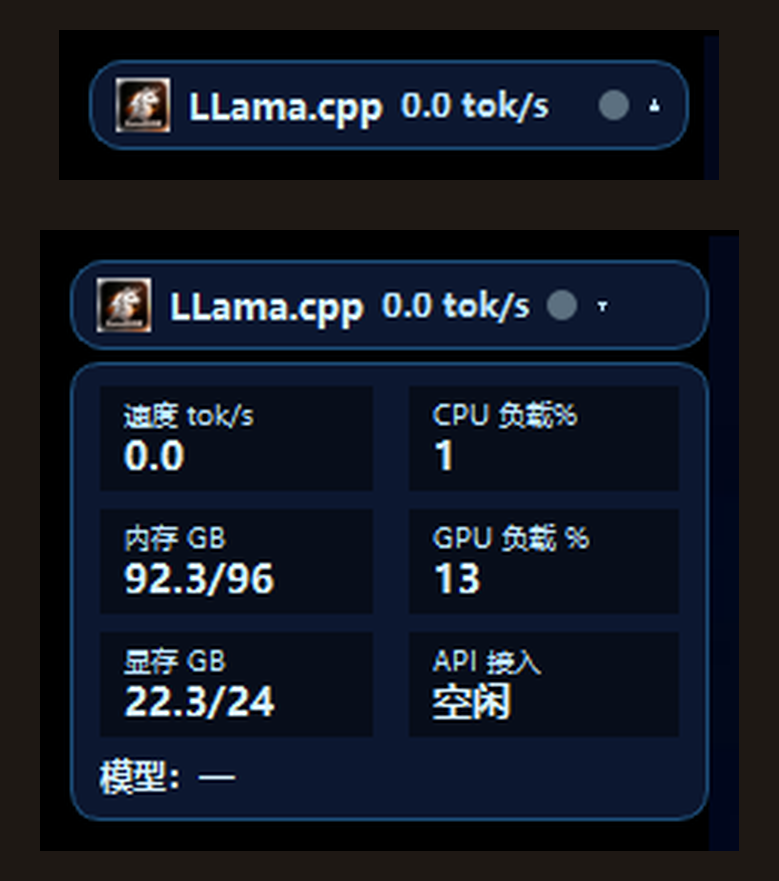

# LLama 启动器

[](https://github.com/lop008/llama-gui-launcher/releases/latest)
[](https://github.com/lop008/llama-gui-launcher/stargazers)
[](LICENSE)
[](#)
[](#)

**[English / English](README.md)**

基于 llama.cpp 的本地大模型图形化启动器。让「选模型 → 配参数 → 后台启动 → 实时监控 → 连接 Agent 工具」整条链路一键搞定，不再需要手敲命令行。
> **最新版本：v0.6.2** —— llama.cpp 0.4.1 删掉了 `--mlock`，启动器改成**按本机版本写出你这份 llama.cpp 真正认识的写法**，服务不再因此起不来；新增启动文件「合理性体检」（AI 分析必须手动点）、界面整体字号缩放、更新页按平台与后端筛选、**MoE「卸载预设」**（按本机显存 + 你选的这个模型每层专家的实际大小算该卸几层，稠密模型不再误收专家参数）。详见 [发布说明](RELEASE_NOTES.md) 与 [更新日志](CHANGELOG.md)。

## 最新版本 v0.6.2 更新

1. **新版 llama.cpp 不再把服务搞崩**：llama.cpp 0.4.1 把 `--mlock` / `--no-mmap` 合并成 `-lm/--load-mode`，旧写法直接 `error: invalid argument`。启动器读本机 `llama-server --help`（按 exe 缓存、启动后后台预热），**写你这份认识的**：新版给 `-lm mmap+mlock` / `-lm none` / `-lm mlock`，旧版仍用 `--mlock` / `--no-mmap`；导入 `.bat` 时同样认识 `-lm`。
2. **启动文件体检**：「工具 → 启动文件 → 校验启动文件」新增**合理性体检**页签，完全离线、按**本机实况**评估——被废弃或不认识的参数、重复设置、取值越界（线程数 vs 逻辑核心、`-ub` vs `-b`、端口）、上下文长度是否超出模型训练上限，以及显存（权重 + KV 缓存 + 计算缓存）、内存、磁盘余量估算。元数据取不到就如实说取不到，不编数字。
3. **「让模型分析」——不点就绝不调用模型**：一个按钮把体检数据（本机配置 + 模型元数据 + 参数，**已剔除 API Key**）交给**本机正在运行**的 llama-server 出报告；不访问任何外部服务，服务未运行时按钮不可点，分析失败时上面的内置结论明确仍然有效。
4. **界面字号缩放**：界面任意处 `Ctrl + 滚轮`，或 `Ctrl` + `+` / `-` / `0`，整体缩放 80%～180%，行高、图标、边距等固定像素量一起等比缩放（否则字放大了控件装不下）。缩放值存 `config.json` 的 `ui_scale`，**不覆盖主题出厂字号**：换主题保持你的缩放，`Ctrl+0` 回到 100%。
5. **更新页筛选真的在筛**：「仅显示有 Windows 包」+ 后端多选下拉（CPU / CUDA / Vulkan / ROCm / SYCL / OpenVINO / OpenCL / zDNN），选项只从当前列表里**真实出现过**的后端生成；同一维度内多选是「或」，维度之间是「且」，一个都不勾 = 不限。「仅显示已下载」改成只认硬盘上真实存在的文件；其他平台的包可为第二台机器下载备用（安装按钮禁用并悬停说明原因）；新增按钮直接打开官方 llama.cpp 下载页。
6. **投机解码把当前模型用不了的方式置灰**：本机不认该取值、或模型既无对应结构也找不到可用草稿 → 置灰并在悬停时说明原因；「缺草稿」保持可选并标 `⚠`（下一个草稿就能用）。配置里存的方式对当前模型失效时自动回退「自动」并在状态栏一次性说明；界面与命令行共用同一份判定函数，两边不会说法不一。
7. **视觉投影按精度择优配对**：F16 > BF16 > F32 > 量化（撞上 F32 那份要多占约一倍显存/内存）；模型带投影文件却留空时给出提示。实测确认 **Inkling 2 是视觉模型**：视觉塔在外挂 mmproj 里（`projection_dim=2304` 与主模型 `embedding_length=2304` 对应），主权重 `has_clip=False` 属正常现象。
8. **命令预览改成可拖两栏**：上半「参数拆解 / 目的与意义」逐条解释，下半完整命令行；拆解只解析**最终命令行文本**，解释与实际下发永远同源；未收录的参数如实标注而不编造。
9. **表格与菜单更听话**：所有列都能拖（只有拖过承担补宽的那一列才停止自动铺满，以前拖任意一列就永久留白）；路径列改中间省略，窗口变窄也看得见文件名；操作列宽度按按钮实测尺寸计算，任何语言、任何字号都不裁字；页签恢复可见描边；工具菜单收进二级。
10. **闪退加固**：`QComboBox.setItemText()` 在反复重建窗口时会崩（改走 model item 设置文本）；后台回调打进正在销毁的界面（残留检测改挂窗口的定时器、状态栏监控改带 `_closing` 闸门的具名槽、只在**真正退出**时停监控且排在「是否同时停止服务」对话框之后）。
11. **MoE「卸载预设」**：高级参数 MoE 行选一个目标（自动 / 全放显存 / 平衡 / 省显存 / 极限省显存 / 长上下文优先），启动器按**本机显存内存 + 这个模型每层专家的实际字节数**算出 `--n-cpu-moe N` 与 `--moe-cache-mib`，并在下一行把计算过程写出来供复核。**故意没做成「显存档位 × 内存档位」的死表**：同样 24 GiB 显存跑 Inkling 2（专家 14.7 GiB）该 N=0，跑 Flash-Next（专家 71.7 GiB）只能 `--cpu-moe`。又因为 `--n-cpu-moe` 卸的是**前 N 层**而动态量化上层更重（Inkling 2 前 21 层 547 MiB、后 3 层 1033 MiB），只能从最上层往下连续试装，不能拿总量除层数。手动改任一项退回「不套用」，换模型或改上下文长度后同一档自动重算；显存或模型信息取不到就直说取不到，绝不编一个 N。
12. **专家参数只发给真有专家的模型**：配置跨模型留存，跑完 MoE 模型设过「前 N 层放 CPU」，切到稠密的 Qwen3.8-27B 命令行还带着 `--n-cpu-moe`。现在 `--cpu-moe` / `--n-cpu-moe` / `--moe-cache-mib` 以**GGUF 张量表逐层实测**的专家字节为准（多分片逐片求和），稠密模型整套 MoE 设置置灰并说明原因、一个参数都不下发，切回 MoE 模型时你原来的设置还在。顺带修掉一个崩溃：把 `attention.head_count` 写成逐层数组的模型（Inkling 2 是 24 个元素）会让「合理性体检」抛 `TypeError`。
13. **预测 Token / 批大小改成可编辑档位下拉**：常用档位（`-1 = 无限输出`、1024～65536 / 256～8192）一点就填，也能直接敲任意数字，超范围自动钳到边界。**运行日志页顶部加了「清屏 / 打开日志目录」**：清屏只清界面显示，磁盘上按天存放的日志文件不动，界面另外只保留最近 5000 行，长时间跑服务不再越吃越多内存。命令预览的「参数拆解」表**真正随窗口横向铺满**：补宽原来跑在 `resizeEvent` 之前、量到的是上一次的视口宽度，最大化后右侧总留一条空白。
14. **微批(-ub) 进界面 + 启动前显存预算**：启动器以前**根本不下发** `-ub`，而它才是「一次真正进 GPU 算多少 token」的旋钮——现在有独立一档。点启动先按「权重 + KV + 批处理激活缓冲」与**当前可用显存**核算，超了就摆出三项数字并给「按建议改微批并启动 / 仍然启动 / 取消」，**绝不静默改设置**；取不到显存时不弹窗。批处理那项是 15 个实测点建的模式（最大偏差 3.7%，偏保守）。
15. **启动器自升级加固**：菜单「关于 → 检查启动器更新…」，另有启动后 6 秒静默检查（只挂标题角标、不弹窗）。原来那步替换脚本是三条 `move`、**一处失败判断都没有**：新版 exe 被安全软件隔离时，旧 exe 已被改名 `.bak`，脚本还照样启动一个不存在的文件——软件就此打不开（本机用真脚本复现过）。现在每步判错、失败自动回滚、绝不启动不存在的文件，下次启动在状态栏说明原因。下载要过大小 + 文件头校验，断点续传不会拼出坏包，升级前先看磁盘余量；并且认得出自己是单文件版还是便携目录版（exe + `_internal`）：**便携版走 `-portable.zip`，连依赖一起换，你的 `config.json` / 日志 / 统计一个都不动**，也不再被单文件包盖掉。
16. **7 种语言完全跟上**：四批共 259 条新增界面文案全部译入繁中 / 英 / 日 / 韩 / 俄 / 西 / 法，并清掉改版失效的 19 条——各表 1199 条，缺失 0、多余 0。

## 一、这个项目解决什么问题？

在本地跑大模型（llama.cpp）时，你通常要面对：

- **命令行繁琐**：`llama-server.exe -m 模型 -ngl all -c 32768 -n 8192 -fa on ...` 一长串参数靠记忆
- **模型难管理**：模型文件散落在多个目录，还要区分视觉模型（mmproj）、跳过未下完的文件
- **后台服务难控制**：黑窗口一闪而过、崩溃后显存不释放、模型跑飞/无限复读停不下来
- **视觉模型容易配错**：主模型和 mmproj 维度不匹配时加载直接失败
- **接 Agent 工具麻烦**：opencode、Claude Code 等要手动配 baseURL、API Key

本启动器把以上全部图形化、自动化：**自动扫描模型、可视化调参、隐藏窗口后台运行、实时监控资源、一键停止、打开 Agent 自动连接服务**。

---

## 二、主要功能

### 模型管理
- **自动扫描**：递归扫描 llama 目录下所有 `.gguf`，自动跳过未下载完成的文件（`.xltd` 等）
- **列表排序**：目录+文件名升序（自然排序，默认）/ 大小降序 / 仅名称
- **视觉模型按目录配对**：选择主模型后**只列出同目录下的 mmproj**；自动选中配套项并做**嵌入维度一致性校验**——不匹配时红字警告 + 启动前拦截，避免"加载失败"报错
- **模型信息**：离线解析 GGUF 头，显示架构/训练上下文/量化格式/参数量，并新增许可证、量化者、基础模型、层数、嵌入/前馈维度、注意力头与 GQA、头维度、RoPE 基数、MTP/NextN 层、SSM state、词表大小、张量数、GGUF 版本、简介与模型主页；支持 Unsloth 动态量化（`UD-*`、`Q4_K_XL` 等），跳过超大数组以加快解析

### 参数配置
- **基本参数**：监听地址、端口、上下文预设（按显存一键推荐 16K~512K）、GPU 层数、上下文长度、预测 Token
- **高级参数**：CPU 线程、批大小、并行 slots、闪存注意力、**KV 缓存 K / V 独立类型**（`-ctk`/`-ctv`，如 K=q8_0 + V=f16）、连续批处理、温度/Top-P/Top-K/重复惩罚、采样预设（严谨/均衡/创意）、API Key、超时、mlock、mmap、自动开浏览器
- **多显卡面板**：`llama-server --list-devices` 检测设备；勾 1 张 = 指定只用该卡，≥2 张 = 拆分模式（`-sm`）/ tensor-split 权重（`-ts`）/ 主 GPU（`-mg`）
- **MTP 多 token 预测**：选模型后自动检测 GGUF 是否含 MTP 张量（支持分片模型；识别 `mtp` / `nextn` / `next_n` / `eh_proj` / `shared_head` 张量及 `nextn_predict_layers` 元数据），可用时勾选启用 `--spec-type draft-mtp` 投机解码提速
- **上下文预设 ↔ 上下文长度联动**：预设点选自动写上下文；手动改上下文自动回显对应档位（非预设值显示「自定义」）
- **每个参数带悬停说明**，完整解释见 `参数说明.md`（菜单「关于 → 参数说明」）

### 服务与监控
- **隐藏窗口后台启动**：`/health` 就绪后自动打开浏览器 Web 界面
- **一键停止**：`taskkill /T` 清理进程树（模型跑飞/无限复读时救命）
- **崩溃防残留（显存自动释放）**：服务进程放入 Windows 作业对象（KILL_ON_JOB_CLOSE），本程序无论崩溃还是被强杀，系统都会自动清理 llama-server 进程树，立即释放显存
- **实时状态监控**：状态栏显示 CPU、内存、显存（nvidia-smi）、**GPU 核心利用率**、运行模型、API 活动与**实时输出速度（tok/s）**
- **托盘悬浮小窗**：点「×」收进托盘后，屏幕右下角常驻置顶胶囊（状态圆点 + 实时 tok/s + API 圆点）；悬停/单击展开速度、CPU、内存、GPU 负载、显存、API 接入数、模型名；可拖动记忆位置、双击返回主界面、右键菜单打开/启动/停止/隐藏/退出

### 网络与安全
- **HTTPS**：一键在 `certs/` 生成自签名证书（`cryptography` 惰性加载），`--ssl-key-file` / `--ssl-cert-file` 贯通服务启动、健康检查、浏览器地址与 opencode 配置（启用 `https`，本地对自签名证书跳过校验）
- **局域网共享**：勾选后 host 自动设为 `0.0.0.0`，并显示供其他设备访问的 `http(s)://<本机IP>:<端口>` 地址
- **联网查询开关**：选择模型时自动向 HuggingFace 补充信息（可关闭以保持纯离线）

### Agent 工具
- 内置 4 个：**opencode**（自动生成 opencode.json 连接服务）、**opencode 桌面版**（自动复制连接信息到剪贴板）、**Claude Code**（保留，不自动连接）、**llama-server**
- 底部「打开 Agent 工具」打开列表当前高亮的工具；**记住上次选中的工具并高亮**，下次启动一眼看到
- 服务运行时打开工具自动连接；服务未运行时正常打开并提示

### 模型下载 & llama.cpp 更新
- **模型下载页**（huggingface.co/unsloth）：**左右双列**（左=模型仓库，右=仓库内文件）；**三栏检索**（A 组织/作者 · B 模型名称/版本 · C 辅助关键词）支持「并 / 或」匹配；按下载量/点赞/名称/更新时间排序；**逐文件表格**（文件名/大小/已安装/下载/进度），表头点击排序，**每行独立断点续传**（HTTP Range + `.part`）；「加载更多」+ 每页数量；仓库信息 + 操作日志（可拖动比例条）；**自定义下载目录**（默认主页模型目录，按仓库建子文件夹）
- **更新 llama.cpp 页**：选择任意 GitHub **Release 版本**（或手输 tag）→ 下载 Windows x64 预编译包 → **安全安装**：只覆盖目标目录同名文件并自动备份 `.bak`，模型/配置等其他文件一律不动；也可切到**分支源码模式**：任选分支（如 `main`），断点续传下载源码 zip 到自选目录下的 `llama.cpp-<分支>` 子目录
- **导出命令预览为 .bat**（工具菜单）：把「命令预览」页的完整命令行原样存成 `.bat`，存储路径任选；另有「导出一键启动(.bat)」并创建桌面快捷方式

### 数据统计（独立窗口：工具 → 数据统计…，或首页第 9 个按钮）
- 按模型统计：**打开次数、使用时长、输入/输出 Token**（解析 llama-server 日志 `prompt eval time` / `eval time`）
- 时间明细支持 **小时 / 日 / 月** 粒度，范围可选 全部/今天/最近一周/本月（自然月），可导出 CSV

### 其他
- **记住上次参数**：自动保存到 `config.json`
- **导出/导入配置**：`.aic` 文件（内容即 JSON），完整备份/还原设置
- **导出一键启动**：把当前模型与参数导出成双击即启动 `llama-server` 的 `.bat`，并自动在桌面创建带软件图标的快捷方式
- **模型联网评估**：用模型名查 HuggingFace，显示简介/下载量/点赞（缓存 7 天，离线自动退回本地信息）
- **托盘最小化**：关闭窗口缩到托盘，托盘菜单可打开悬浮窗/启动/停止/退出
- **底部标签可拖动排序**：拖动调整顺序，保存到 `config.json`，下次启动恢复
- **日志落盘**：`logs/运行日志-YYYYMMDD.log` 按天分文件
- **六套主题配色**（深色 / 浅色 / 橙色 / 绿色 / 灰色 / 棕色）：状态栏右下角「🎨 主题」菜单选择，切换不改变布局尺寸
- **可自定义图标 / 广告位**：放入 `assets/icon.ico` 换图标；`assets/ad.png` 显示在底部 430×40 广告位

---

## 三、安装方法

### 方式 A：源码运行（开发/自用）

**环境要求**
- Windows
- Python 3.9+（本机验证 3.13）
- 目录内需有 llama.cpp 的 `llama-server.exe` 及配套 DLL（从 llama.cpp Releases 解压）

**步骤**
```bat
cd /d 你的启动器目录
pip install -r requirements.txt
python main.py
```

依赖（`requirements.txt`）：`PyQt6`、`requests`、`psutil`、`cryptography`

### 方式 B：直接运行打包好的 exe（无需安装 Python）

从 [Releases](https://github.com/lop008/llama-gui-launcher/releases) 页面下载：

| 文件 | 说明 |
|------|------|
| `LLama-Launcher-v0.6.2-win-x64.exe` | **单文件版**（x64，约 47 MB），双击即运行。首次启动较慢（需解压到临时目录，约几秒）；个别杀毒软件可能误报，加入白名单即可。 |
| `LLama-Launcher-v0.6.2-win-x64-portable.zip` | **便携版**（x64），解压后运行 `LLama启动器-win-x64-portable.exe`，启动更快、无需自解压。 |
| `LLama-Launcher-v0.6.2-win-arm64.exe` | **单文件版**（ARM64），适用于骁龙笔记本 / Windows on ARM 设备。 |
| `LLama-Launcher-v0.6.2-win-arm64-portable.zip` | **便携版**（ARM64），解压即用。 |
| `Arm64.bat` | **ARM64 一键启动脚本**：与 exe 放同一目录后双击，永远优先挑 arm64 包（同目录混放了 x64 也不会拿错；仓库自带的 `一键启动.bat` 对应 x64，优先 x64）。 |

将 `llama-server.exe` 及配套 DLL 放到同一目录（或在界面中指定启动器路径）。

---

## 四、使用方法

### 快速上手
1. **设置 llama 目录**：选择 llama.cpp 所在文件夹（含 `llama-server.exe`），点「刷新模型」
2. **选模型**：下拉选择主模型；视觉模型自动按目录配对（维度不匹配会有红色警告，可改选或选「不使用」）
3. **调参数**：端口默认 8080、监听地址 `127.0.0.1`；可用「上下文预设」按显存一键推荐上下文；高级参数按需展开
4. **启动**：点「启动服务」→ 隐藏窗口后台运行 → 就绪后自动打开浏览器 Web 界面（`http://127.0.0.1:8080/`）
5. **监控**：状态栏实时显示 CPU/内存/显存/运行模型/API 活动
6. **停止**：模型跑飞、幻觉复读时点「停止服务」一键终止
7. **接 Agent**：切到「Agent 工具」页选中工具 → 点底部「打开 Agent 工具」（服务运行时自动连接）

### 菜单说明
| 菜单 | 项目 |
|------|------|
| 开始 | 启动服务 / 停止服务 / 退出 |
| 工具 | 刷新模型 / 打开模型目录 ｜ 打开管理页面 / 查看 API 模型列表 ｜ 打开 Agent 工具 ｜ 导出配置(.aic) / 导入配置(.aic) / 导出一键启动(.bat)（并在桌面创建带软件图标的快捷方式）/ **导出命令预览(.bat)…（自选存储路径）** / **数据统计…（独立窗口）** ｜ 清空日志 / 打开日志目录 |
| 关于 | 参数说明 / 开发者信息 |

---

## 五、输入输出示例

### 1. 启动命令示例

界面点「启动服务」后，底部「命令预览」和日志会显示**实际执行的命令行**。例如：

```
llama-server.exe -m <你的模型路径，如 D:\models\gemma-4-31B-it-Q6_K.gguf>
  --mmproj <你的视觉模型路径，如 D:\models\mmproj-BF16.gguf>
  -ngl all -c 32768 -n 8192 -fa on --cont-batching
  --host 127.0.0.1 --port 8080
  -b 2048 -ctk f16 -ctv f16
  --temp 0.80 --top-k 40 --top-p 0.95 --repeat-penalty 1.00
  --timeout 3600 -a gemma-4-31B-it-Q6_K
```

### 2. 启动日志示例（「运行日志」页）

```
[防护] 已启用 Job Object：本程序退出/崩溃时，llama-server 将被系统自动清理，显存立即释放
common_params_print_info: verbosity = 3
srv  load_model: loading model '<你的模型路径>'
服务已就绪: http://127.0.0.1:8080
```

### 3. 浏览器 / API 地址

- Web 聊天界面：`http://127.0.0.1:8080/`
- OpenAI 兼容接口：`http://127.0.0.1:8080/v1`

用 curl 测试接口（输入/输出）：

```
curl http://127.0.0.1:8080/v1/chat/completions ^
  -H "Content-Type: application/json" ^
  -d "{\"model\":\"gemma-4-31B-it-Q6_K\",\"messages\":[{\"role\":\"user\",\"content\":\"你好\"}],\"max_tokens\":64}"
```

输出（节选）：

```json
{
  "id": "chatcmpl-...",
  "object": "chat.completion",
  "model": "gemma-4-31B-it-Q6_K",
  "choices": [{ "message": { "role": "assistant", "content": "你好！很高兴见到你……" } }]
}
```

### 4. Agent 自动连接示例

服务运行时打开 opencode，启动器自动在 llama 目录写入 `opencode.json`（备份并合并已有配置）：

```json
{
  "$schema": "https://opencode.ai/config.json",
  "provider": {
    "llama.cpp": {
      "npm": "@ai-sdk/openai-compatible",
      "name": "llama-server (local :8080)",
      "options": { "baseURL": "http://127.0.0.1:8080/v1" },
      "models": { "gemma-4-31B-it-Q6_K": { "name": "gemma-4-31B-it-Q6_K" } }
    }
  }
}
```

### 5. 配置导出示例

「工具 → 导出配置」生成 `xxx.aic`（内容即 JSON，与 `config.json` 结构一致），可在另一台机器「导入配置」还原全部设置。

---

## 目录结构

```
LLama启动器/
├── main.py                # 程序入口
├── requirements.txt       # 依赖
├── 参数说明.md             # 每个参数的完整解释
├── .gitignore
├── config.json            # 运行配置（自动生成，含 API Key，请勿上传）
├── hf_model_cache.json    # HF 查询缓存（自动生成）
├── logs/                  # 运行日志（自动生成）
├── assets/
│   ├── icon.ico           # 程序图标（可选，放入即生效）
│   ├── ad.png             # 底部广告位 430×40（可选）
│   └── donate_qr.jpg      # 开发者信息中的捐款二维码（可选）
├── docs/
│   ├── cover.png          # 发布封面图（v0.3.85）
│   └── screenshots/       # README / Release 引用的界面截图
├── certs/                 # 自签名 HTTPS 证书/私钥（自动生成，请勿上传）
├── dist/                  # 打包好的可执行文件（pyinstaller 生成，不入库）
└── src/
    ├── main_window.py       # 主窗口 + 菜单 + 托盘 + 状态栏
    ├── config.py            # 配置读写
    ├── themes.py            # 六套配色（深/浅/橙/绿/灰/棕）
    ├── model_scanner.py     # 模型扫描 / 排序 / mmproj 配对
    ├── gguf_reader.py       # GGUF 头解析 + MTP 张量检测
    ├── cmd_builder.py       # 命令行生成（KV K/V、多显卡、MTP、HTTPS）
    ├── server.py            # 子进程 / 健康检查 / 停止 / 作业对象
    ├── jobobject.py         # Windows 作业对象（崩溃自动清理）
    ├── system_monitor.py    # CPU/内存/显存/GPU/API/速度监控
    ├── net_utils.py         # 本机 IP 探测 + 自签名证书生成
    ├── pill.py              # 托盘悬浮小窗（胶囊 + 展开数据卡片）
    ├── hf_info.py           # HuggingFace 模型评估
    ├── hf_browse.py         # HF 仓库检索 / 文件列表（下载页后端）
    ├── hf_download_tab.py   # 模型下载 UI（双列、三栏检索、逐文件续传）
    ├── model_downloader.py  # 断点续传 HTTP 下载器（.part + Range）
    ├── llama_updater.py     # llama.cpp Release/分支获取 + 安全安装
    ├── updater_tab.py       # 更新 llama.cpp UI（版本 / 分支源码）
    ├── usage_stats.py       # 使用统计存储（打开次数/时长/token，时日月分桶）
    ├── stats_dialog.py      # 独立数据统计窗口
    ├── bat_validator.py     # .bat/.cmd/.ps1 启动脚本静态校验
    ├── presets.py           # 上下文预设 / 采样预设
    ├── tools.py             # Agent 工具注册与检测
    ├── opencode_launcher.py # 生成 opencode.json
    └── about_dialog.py      # 开发者信息
```

## 界面截图

| | |
|---|---|
|  | |
| 托盘悬浮小窗（收起 + 悬停展开） | |
|  |  |
| 主界面 | 高级参数 + 多显卡 |
|  |  |
| 模型下载（双列、断点续传） | 更新 llama.cpp |
|  |  |
| Agent 工具 | 命令预览 |

## 开发者信息

- 开发者：AI创客师
- 哔哩哔哩入口见「关于 → 开发者信息」（链接可点击直达）
- 如需更换：编辑 `src/about_dialog.py` 顶部常量

## 二次开发规划

- [x] 模型下载通道（HuggingFace，默认组织 `unsloth`；断点续传队列 + 保存目录选择）
- [x] llama.cpp 应用内更新（Release 版本安全安装；分支源码 zip 下载）
- [ ] 模型评估接入 ModelScope 来源
