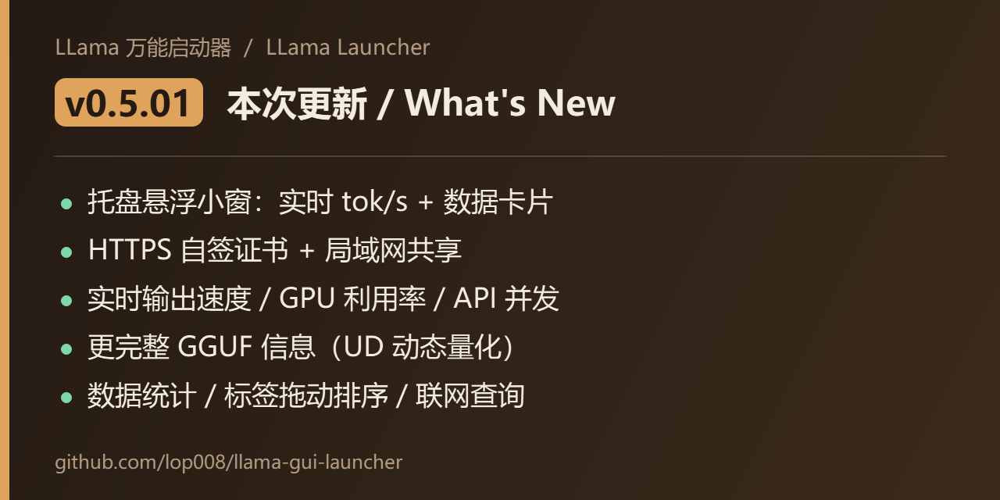
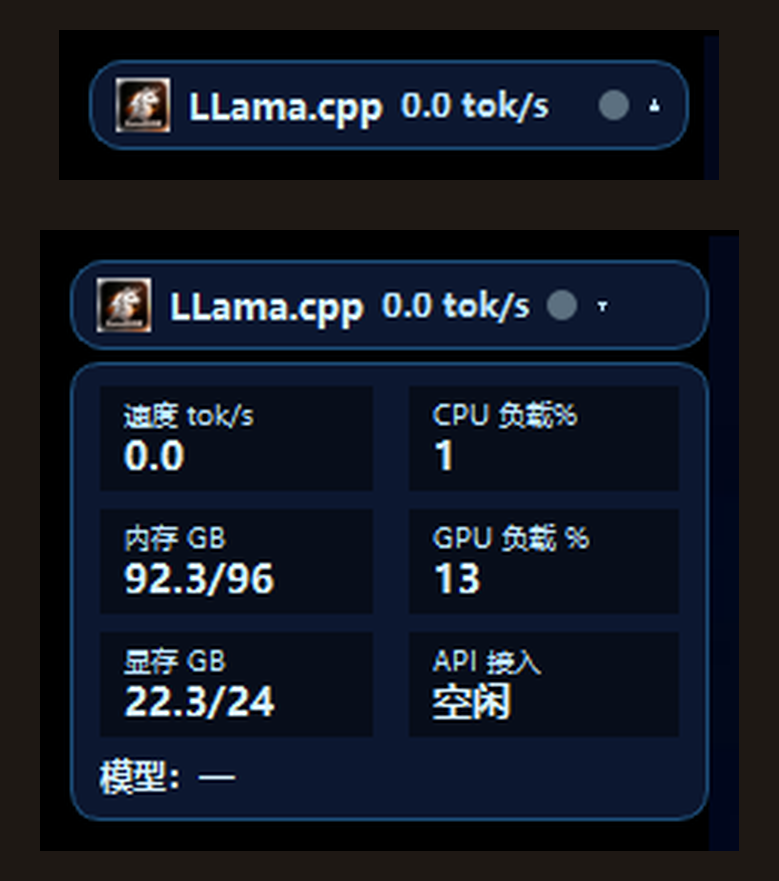
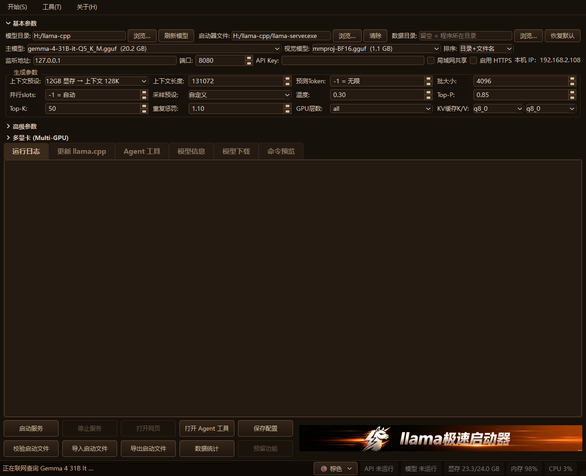
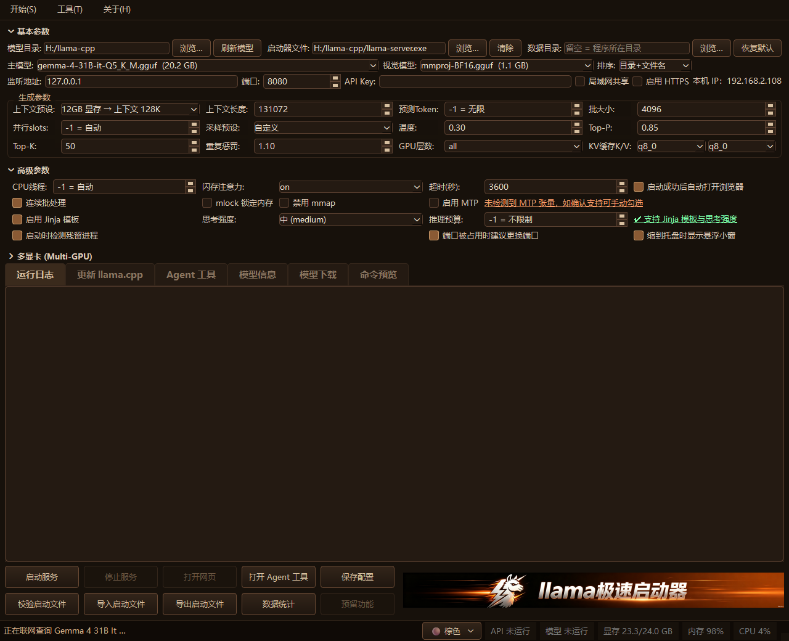
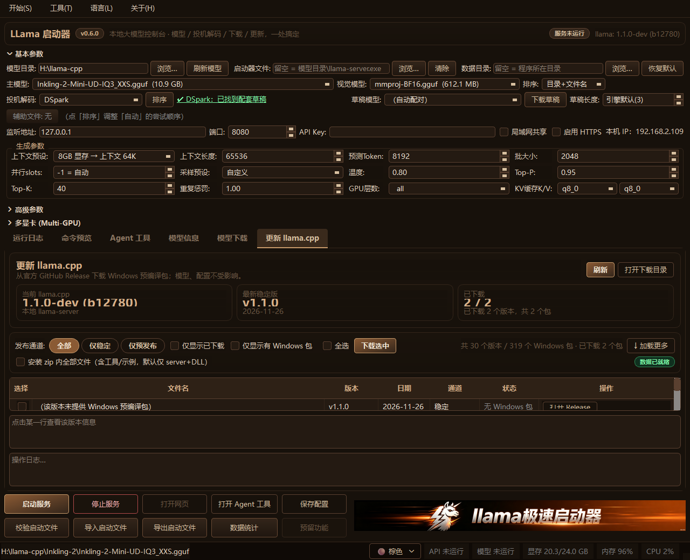

## LLama 万能启动器 v0.5.01

基于 llama.cpp 的本地大模型图形化启动器。自动扫描模型、可视化调参、隐藏窗口后台运行、实时监控、一键连接 Agent 工具。

A GUI launcher for llama.cpp local LLMs. Auto-scan models, visual parameter tuning, hidden-window background startup, real-time monitoring, one-click Agent tool connection.

### 本次更新 / What's New in v0.5.01

1. 🫧 **托盘悬浮小窗** — 收进托盘后屏幕右下角常驻 30 像素高置顶胶囊：程序图标 → LLama.cpp → 实时 tok/s → 状态圆点；悬停/单击展开数据卡片（速度、CPU、内存、GPU 负载、显存、API 接入数、模型名，系统数据在服务未运行时也显示）；拖动记忆位置、双击返回主界面、右键菜单，配色跟随主题
2. 📈 **数据统计** — 首页第 9 个按钮与「工具 → 数据统计…」打开同一个独立窗口（原「模型统计」统一更名），查看打开次数 / 使用时长 / 输入·输出 token，支持按小时 / 日 / 月查看与 CSV 导出
3. ⚡ **实时输出速度** — 对 llama-server `/metrics` 生成计数器差分得到 tok/s，旧版自动回退解析 `eval time` 日志行；新增 GPU 核心利用率与 API 并发占用数
4. 🔒 **HTTPS + 局域网共享** — 一键生成自签名证书（`cryptography` 惰性加载），`--ssl-key-file` / `--ssl-cert-file` 全链路生效；勾选局域网共享时 host 自动设为 `0.0.0.0`，并显示可访问的 `http(s)://<本机IP>:<端口>`
5. 📊 **更完整的 GGUF 信息** — 支持 Unsloth 动态量化（`UD-*`、`Q4_K_XL`），跳过超大数组显著提速；展示参数量/许可证/量化者/基础模型/层数/嵌入与前馈维度/注意力头与 GQA/RoPE/MTP/SSM/词表/张量数/GGUF 版本/简介/主页
6. 🗂️ **底部标签可拖动排序** — 顺序持久化到 `config.json`，下次启动恢复
7. 🛠️ **其他改进** — 模型信息区新增「联网查询」开关；更新器支持自定义目标目录；`一键启动.bat` 自动定位 exe / 便携 Python 并自愈依赖；启动文件校验器识别 SSL 参数

### 主要功能 / Features

- 自动扫描模型 + 视觉模型按目录配对 + 维度一致性校验
- 可视化参数配置（上下文/采样预设联动、KV 量化、MTP、多显卡、Flash Attention、对话模板）
- 隐藏窗口后台启动，`/health` 就绪自动打开浏览器
- 崩溃防残留（Windows 作业对象，显存自动释放）
- 实时状态栏监控（CPU / 内存 / 显存 / GPU / 模型 / API 活动 / 输出速度）+ 托盘悬浮小窗
- HTTPS 自签名证书 / 局域网共享 / 在线模型查询
- Agent 工具自动连接（opencode 自动生成配置等）
- 托盘最小化 / 可拖动标签 / 日志落盘 / 六套主题 / 导出导入配置(.aic) / 导入导出启动文件
- 模型下载（HuggingFace，断点续传）与 llama.cpp 在线更新

### 截图 / Screenshots

### 下载 / Downloads

| 文件 | 说明 |
|------|------|
| `LLama-Launcher-v0.5.01-win-x64.exe` | 单文件版，无需安装 Python，双击即用 |
| `LLama-Launcher-v0.5.01-win-x64-portable.zip` | 便携版，解压即用 |
| Source code (zip / tar.gz) | 源码 |

### 关于 / About

开发者：AI创客师 · License: MIT
