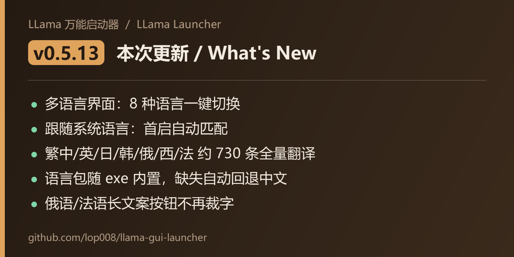
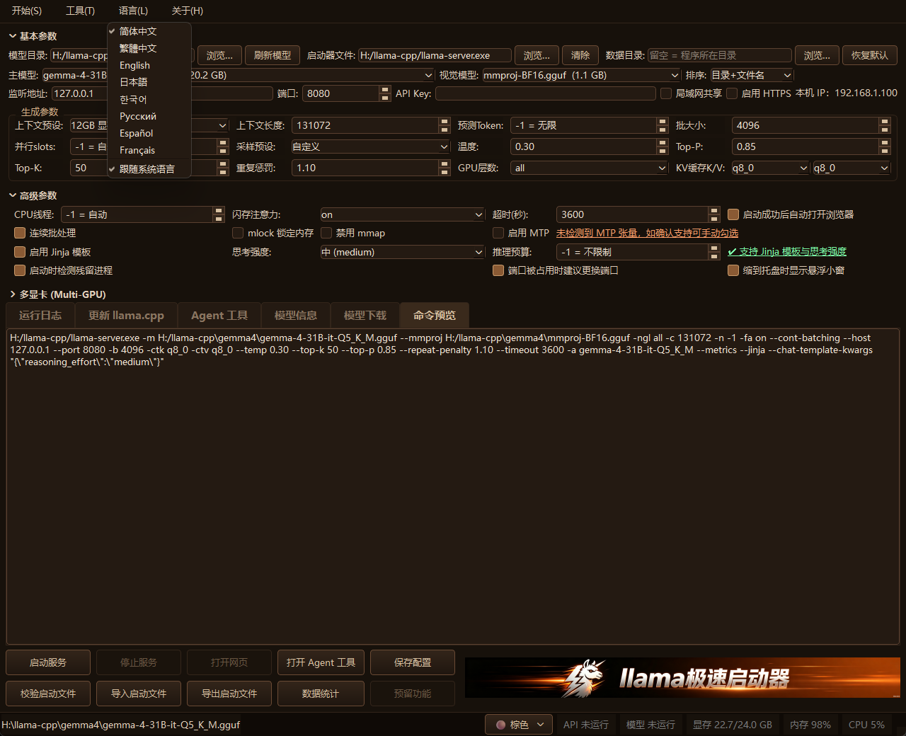
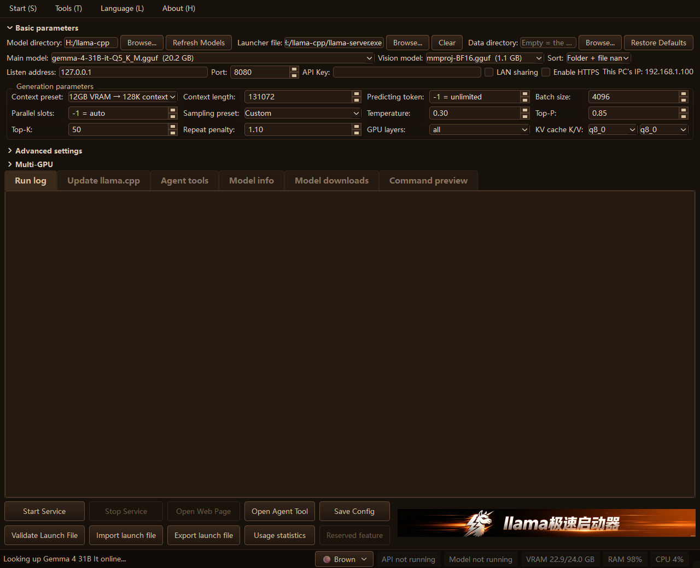
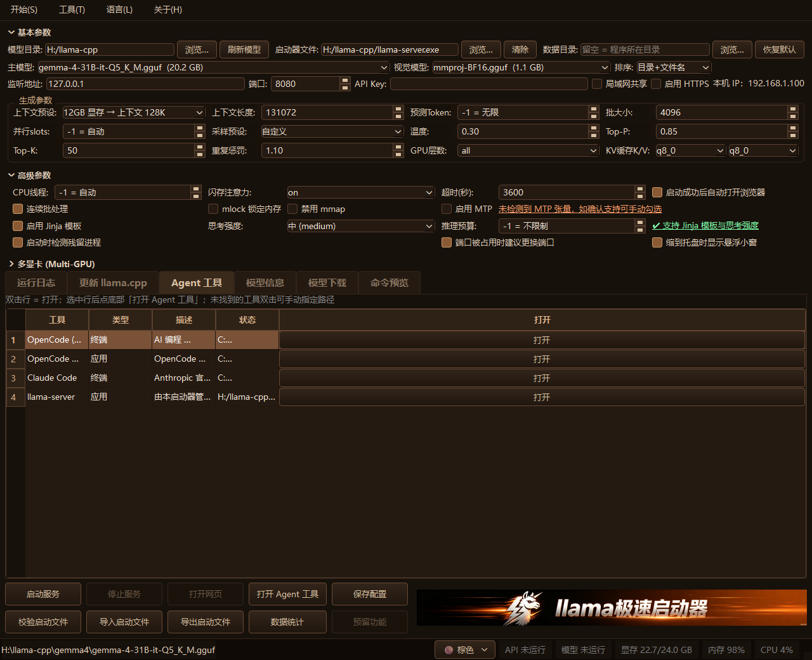

## LLama 万能启动器 v0.5.13

基于 llama.cpp 的本地大模型图形化启动器。自动扫描模型、可视化调参、隐藏窗口后台运行、实时监控、一键连接 Agent 工具。

A GUI launcher for llama.cpp local LLMs. Auto-scan models, visual parameter tuning, hidden-window background startup, real-time monitoring, one-click Agent tool connection.

### 本次更新 / What's New in v0.5.13

- 🌐 **多语言界面** — 新增「语言」菜单，8 种界面语言一键切换：简体中文 / 繁體中文 / English / 日本語 / 한국어 / Русский / Español / Français（New multilingual UI with 8 languages）
- 🪄 **跟随系统语言** — 首次启动自动匹配操作系统语言，手动切换后记住选择（Follow-system language on first launch）
- 🈶 **约 730 条文案全量翻译** — 7 张语言表随 exe 内置分发，缺失译文自动回退简体中文（~730 translated strings per language, built into the exe）
- 🔤 **长文案不再裁字** — 按钮改用最小宽度，俄语/法语等长文本完整显示（long Russian / French labels no longer clipped）
- 🧹 **版本号单一来源** — exe 版本资源打包时自动生成，发版不再多处手改（single source of truth for the version）
- 🐛 **修复** — 工具扫描回调遮蔽翻译函数导致的闪退；韩语「浏览…/深色」译文错位

### 主要功能 / Features

- **8 种语言界面** + 跟随系统语言 + 切换记忆（v0.5.13 新增）
- 自动扫描模型 + 视觉模型按目录配对 + 维度一致性校验
- 可视化参数配置（上下文/采样预设联动、KV 量化、MTP、多显卡、Flash Attention）
- 隐藏窗口后台启动，`/health` 就绪自动打开浏览器
- 崩溃防残留（Windows 作业对象，显存自动释放）
- 实时状态栏监控（CPU / 内存 / 显存 / 模型 / API 活动）+ 托盘悬浮小窗（实时 tok/s）
- HTTPS 自签名证书 + 局域网共享
- Agent 工具自动连接（opencode 自动生成配置等）
- 托盘最小化 / 日志落盘 / 六套主题 / 导出导入配置(.aic)
- 模型下载（HuggingFace，断点续传）与 llama.cpp 在线更新

### 截图 / Screenshots

多语言菜单（8 语言 + 跟随系统）/ Language menu:

英文界面效果 / English UI:

更多界面 / More（棕色主题 / brown theme）:

### 下载 / Downloads

| 文件 | 说明 |
|------|------|
| `LLama-Launcher-v0.5.13-win-x64.exe` | 单文件版，无需安装 Python，双击即用 |
| `LLama-Launcher-v0.5.13-win-x64-portable.zip` | 便携版，解压即用 |
| Source code (zip / tar.gz) | 源码 |

### 关于 / About

开发者：AI创客师 · License: MIT
