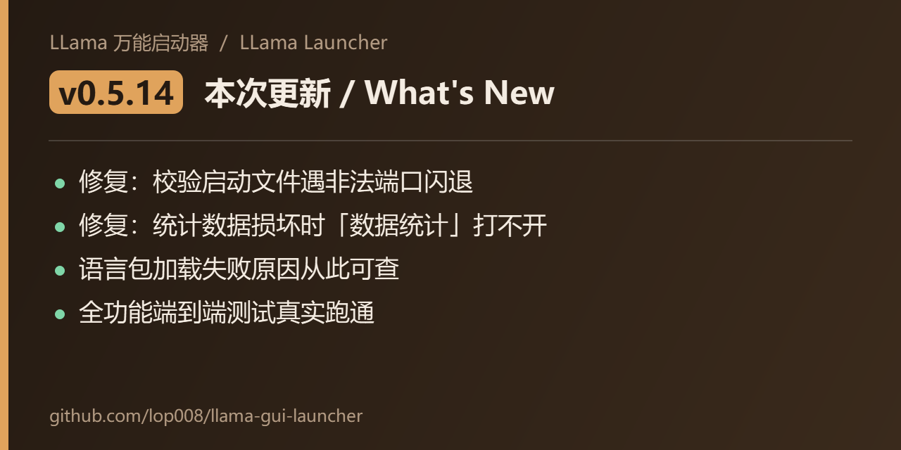
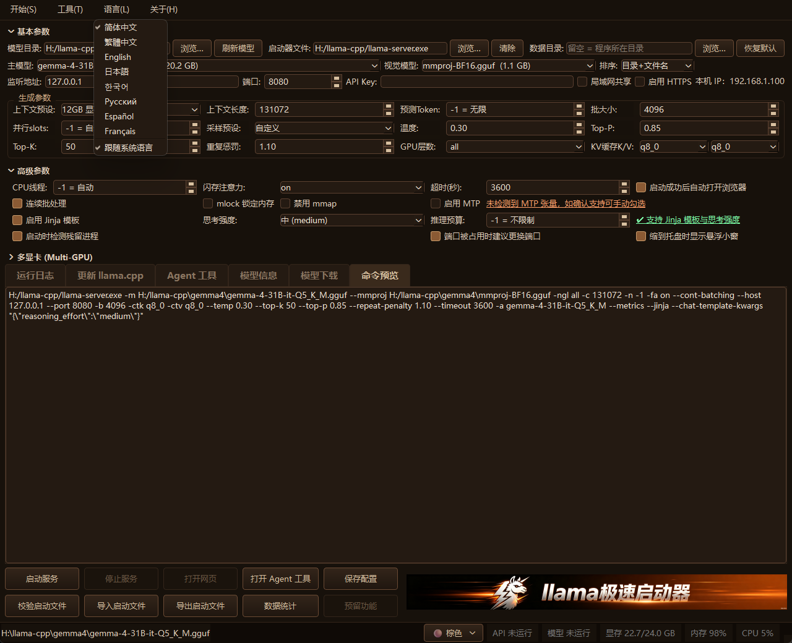
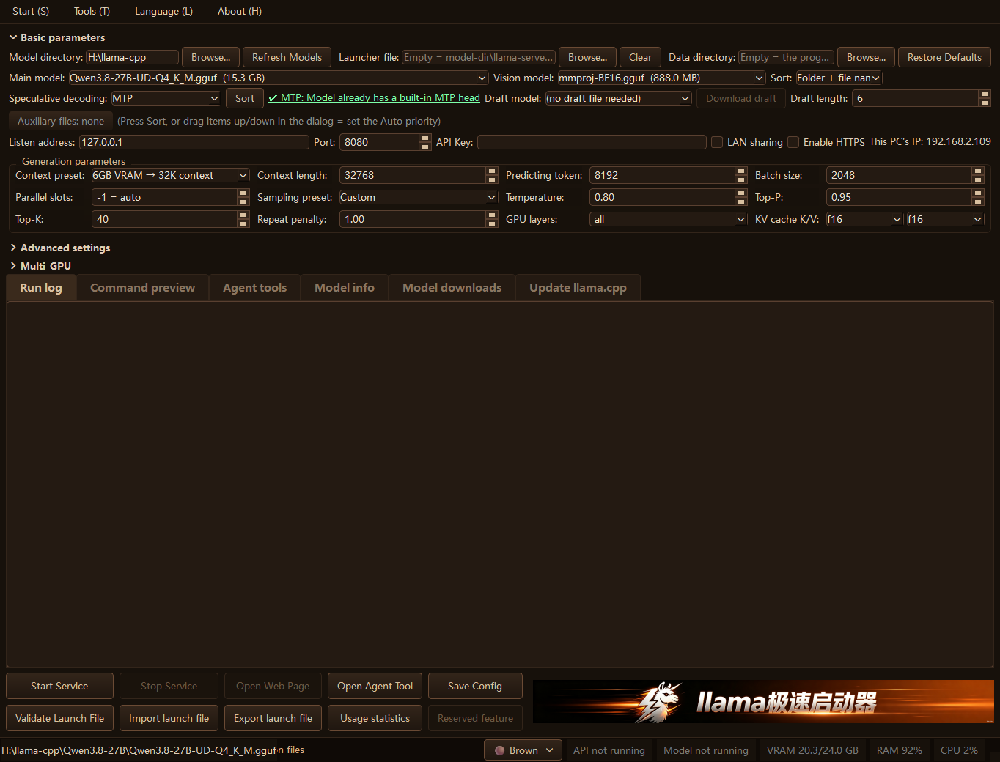

## LLama 万能启动器 v0.5.14

基于 llama.cpp 的本地大模型图形化启动器。自动扫描模型、可视化调参、隐藏窗口后台运行、实时监控、一键连接 Agent 工具。

A GUI launcher for llama.cpp local LLMs. Auto-scan models, visual parameter tuning, hidden-window background startup, real-time monitoring, one-click Agent tool connection.

> 本版为**稳定性版本**（界面与功能无变化）：用一套真实启动 llama-server 的端到端测试把全部功能过了一遍，修掉两处闪退。
> This is a **stability release** (no UI/feature changes): a new end-to-end suite that really starts llama-server exercised every feature and two crash bugs were fixed.

### 本次更新 / What's New in v0.5.14

- 🐛 **修复：校验启动文件遇非法端口闪退** — 脚本里写 `--port 99999` / `--port 0` 时校验流程会被未捕获的 `OverflowError` 打断，现在先做 1–65535 范围校验并给出明确提示（`✘ --port 超出合法范围（1-65535）`，8 种语言同步）。Validation no longer crashes on an out-of-range `--port` — you get a clear message instead.
- 📊 **修复：`stats.json` 损坏时「数据统计」打不开** — 一条结构异常记录（条目非对象、数值为字符串 / `null` / `NaN`）就会让窗口打开报错、服务运行期间的统计定时器反复报错；现在跳过坏记录、其余统计照常，并在下次写入时自动修复。Data Statistics survives a corrupted `stats.json`: bad records are skipped and repaired automatically.
- 🔍 **语言包加载失败不再静默** — 打包后某张语言表加载失败（文件缺失 / 语法错误 / 表为空）时，以前只是悄悄回退简体中文；现在原因写入 stderr，也可用 `i18n.failed_languages()` 查询 `{语言代码: 原因}`。Silent language-table fallback is now observable.
- 🧪 **全功能端到端测试** — 真实启动服务跑通完整 OpenAI 接口（`/health` `/props` `/slots` `/tokenize` `/metrics` `/v1/models`、流式与非流式 `/v1/chat/completions`、旧版 `/completion`）、API Key 鉴权、看门狗清理、导出 `.bat` 实跑、HTTPS 自签证书、局域网共享与悬浮窗实时 tok/s / 显存读数；10 个套件一条命令串行跑完并输出通过矩阵。New end-to-end suites that really start the server and cover the whole OpenAI surface, auth, watchdog, exported scripts, HTTPS and LAN.

### 主要功能 / Features

- 8 种语言界面 + 跟随系统语言 + 切换记忆
- 自动扫描模型 + 视觉模型按目录配对 + 维度一致性校验
- 可视化参数配置（上下文/采样预设联动、KV 量化、MTP、多显卡、Flash Attention）
- 隐藏窗口后台启动，`/health` 就绪自动打开浏览器
- 崩溃防残留（Windows 作业对象，显存自动释放）
- 实时状态栏监控（CPU / 内存 / 显存 / 模型 / API 活动）+ 托盘悬浮小窗（实时 tok/s）
- HTTPS 自签名证书 + 局域网共享
- Agent 工具自动连接（opencode 自动生成配置等）
- 托盘最小化 / 日志落盘 / 六套主题 / 导出导入配置(.aic)
- 模型下载（HuggingFace，断点续传）与 llama.cpp 在线更新

### 截图 / Screenshots

多语言菜单（8 语言 + 跟随系统）/ Language menu:

英文界面效果 / English UI:

更多界面 / More（棕色主题 / brown theme）:

### 下载 / Downloads

| 文件 | 说明 |
|------|------|
| `LLama-Launcher-v0.5.14-win-x64.exe` | 单文件版，无需安装 Python，双击即用 |
| `LLama-Launcher-v0.5.14-win-x64-portable.zip` | 便携版，解压即用 |
| Source code (zip / tar.gz) | 源码 |

### 关于 / About

开发者：AI创客师 · License: MIT
