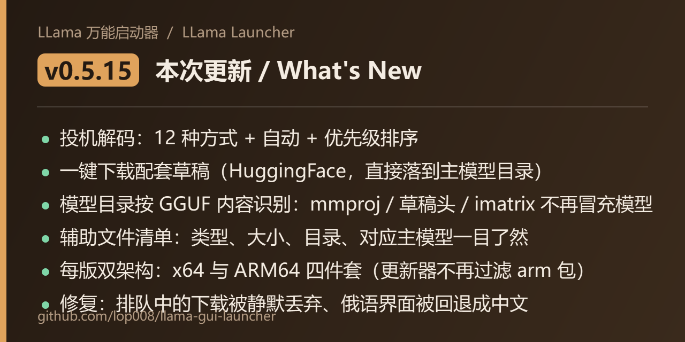
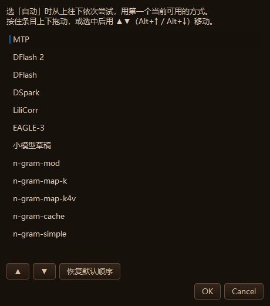
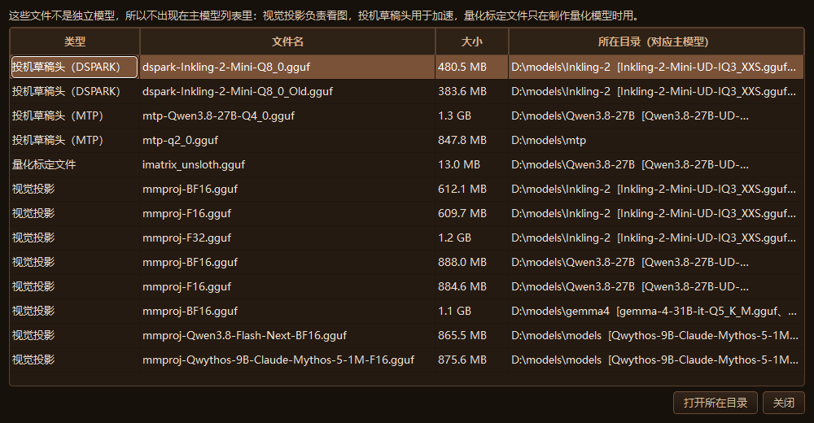
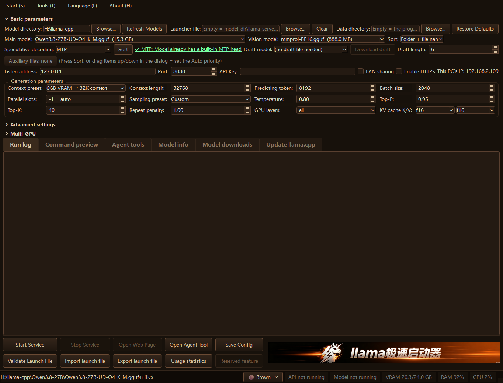
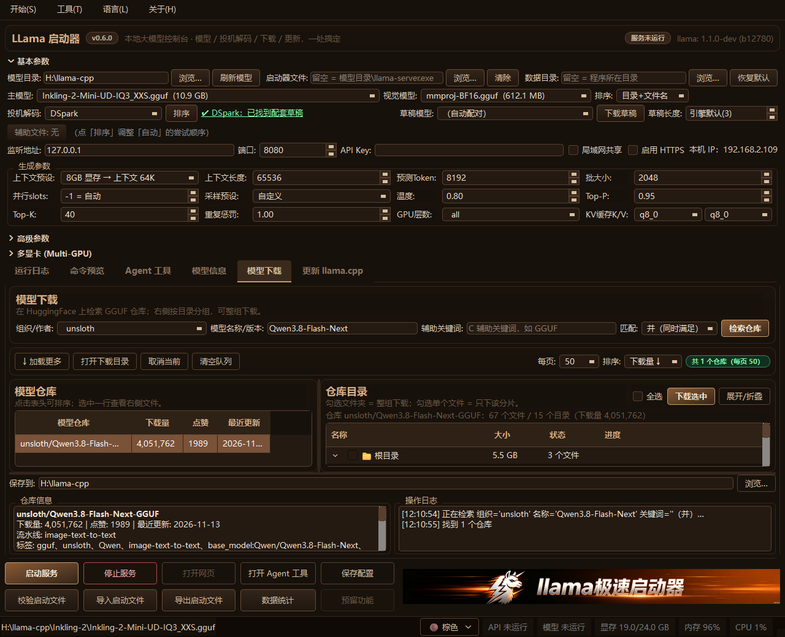
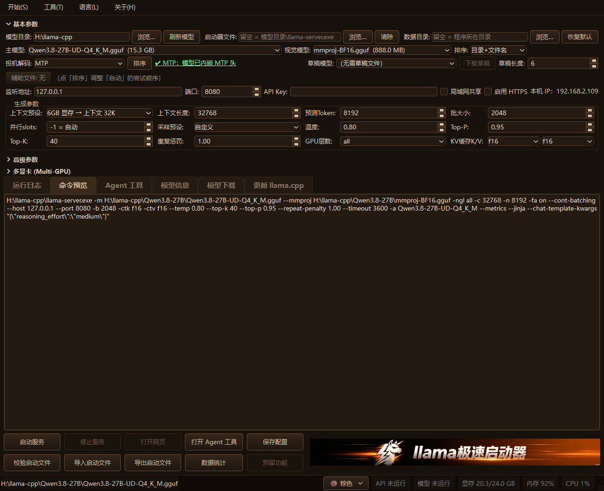

## LLama 万能启动器 v0.5.15

基于 llama.cpp 的本地大模型图形化启动器。自动扫描模型、可视化调参、隐藏窗口后台运行、实时监控、一键连接 Agent 工具。

A GUI launcher for llama.cpp local LLMs. Auto-scan models, visual parameter tuning, hidden-window background startup, real-time monitoring, one-click Agent tool connection.

> 本版为**功能版本**：投机解码正式做进界面，模型目录按文件真实身份筛查，并从本版起每个版本同时发布 **x64 与 ARM64** 两套产物。
> This is a **feature release**: speculative decoding becomes a first-class part of the UI, the model folder is screened by what each GGUF actually *is*, and from this version every release ships **both x64 and ARM64**.

### 本次更新 / What's New in v0.5.15

- ⚡ **投机解码（Speculative Decoding）** — 高级页的「启用 MTP」勾选框升级成基础页模型行下方的完整控件组：**不启用 / 自动** + 12 种方式（MTP、DFlash 2、DFlash、DSpark、LiliCorr、EAGLE-3、小模型草稿、4 种 n-gram），配状态标签、`草稿模型` 选择、`草稿长度`（`--spec-draft-n-max`）。支持与否全部**实测**：读本机 `llama-server --help` 看引擎认哪些取值、读模型 GGUF 看有无内嵌 MTP 头、看草稿与主模型配不配对。本机不认的方式置灰并写明原因；**「自动」在没有任何可用方式时完全不下发 `--spec-type`**，投机解码绝不会变成服务起不来的原因。Speculative decoding with 12 methods + Auto, detected from your own engine and model files — and Auto passes no flag at all when nothing is usable, so it can never break a launch.
- 🔽 **下载草稿** — 按当前模型在 HuggingFace 上找配套草稿，官方 GGUF 发布方（ggml-org / unsloth / bartowski）优先，列表给出方式 / 文件 / 仓库 / 大小 / 说明，下载直接落到**主模型所在目录**（草稿必须同目录才会配对）并自动选中；只放 safetensors 的原作者仓库不提供假下载，改为给出完整的 `convert_hf_to_gguf.py … --target-model-dir …` 命令。
- 🔎 **模型目录角色筛查 + 辅助文件清单** — 视觉投影（mmproj）、投机草稿头、量化标定文件（imatrix）不再冒充「主模型」；判定以 GGUF **内容**为准（张量名 / `general.type` / 架构），文件名只作兜底，**读不出来的文件一律当主模型**（宁可偶尔多显示，绝不静默藏掉真模型）。模型区下方新增一行摘要，点开是明细表：类型 / 文件名 / 大小 / 所在目录 / 对应主模型。
- 🧭 **「自动」优先级排序** — 下拉旁的「排序」按钮：按住条目上下拖动，或用 ▲▼ / Alt+↑ / Alt+↓ 调整自动尝试顺序，顺序保存，以后新增的方式自动补在后面。
- 🦄 **每版双架构（x64 + ARM64）** — 「更新 llama.cpp」页不再过滤名字带 `arm` 的资产（官方每个版本都有 4 个 arm64 包），两种架构都列出、本机架构排最前；启动器自本版起发布 4 个产物。
- 🐛 **修复：排队中的下载被静默丢弃** — 正在下载时再点第二个文件，以前什么都不发生、也没有提示。
- 🐛 **修复：俄语界面被悄悄回退成中文** — `src/locales/ru.py` 最后一条缺少尾逗号导致整张表解析失败。
- 🐛 **修复：中文系统上「启动时检测残留进程」静默失效** — `tasklist` 在「没有匹配进程」时输出 GBK 文本，`subprocess` 的内部读线程解码失败导致结果永远为空；现在所有按文本读取的子进程都显式指定编码，并加了静态门禁防止回归。
- 🧩 **主窗口模块化** — `src/main_window.py` 从 3338 行拆到约 500 行，界面控件、后台任务、各页布局、GPU/模型探测、启动流程、启动文件读写、Agent 工具、托盘悬浮窗、偏好设置、配置读写、关于菜单分别移入 `src/ui/` 下的 Mixin，**行为逐字不变**。
- 🌍 **语言表与源码严格对齐** — 93 条新文案翻译进全部 7 张语言表（英 / 繁中 / 日 / 韩 / 俄 / 西 / 法），并清理掉旧 MTP 勾选框遗留的 7 条死文案：820 个 key，缺失 0、多余 0。

### 主要功能 / Features

- 投机解码：12 种方式 + 自动 + 优先级排序 + 草稿模型一键获取
- 8 种语言界面 + 跟随系统语言 + 切换记忆
- 自动扫描模型 + 视觉模型按目录配对 + 辅助文件角色筛查与清单
- 可视化参数配置（上下文/采样预设联动、KV 量化、多显卡、Flash Attention）
- 隐藏窗口后台启动，`/health` 就绪自动打开浏览器
- 崩溃防残留（Windows 作业对象，显存自动释放）
- 实时状态栏监控（CPU / 内存 / 显存 / 模型 / API 活动）+ 托盘悬浮小窗（实时 tok/s）
- HTTPS 自签名证书 + 局域网共享
- Agent 工具自动连接（opencode 自动生成配置等）
- 托盘最小化 / 日志落盘 / 六套主题 / 导出导入配置(.aic)
- 模型下载（HuggingFace，断点续传）与 llama.cpp 在线更新（x64 与 arm64 都列出）

### 截图 / Screenshots

投机解码 · 「自动」优先级排序对话框 / Auto priority dialog:

辅助文件明细表（视觉投影 / 投机草稿头 / 量化标定文件）/ Auxiliary files inspector:

主界面（模型行下方新增「投机解码」行与辅助文件摘要）/ Main page with the new speculative-decoding row:

英文界面效果 / English UI:

高级参数（本页原有的「启用 MTP」已升级为投机解码控件组）/ Advanced page:

更多界面 / More（棕色主题 / brown theme）:

### 下载 / Downloads

| 文件 | 说明 |
|------|------|
| `LLama-Launcher-v0.5.15-win-x64.exe` | 单文件版（x64），无需安装 Python，双击即用 |
| `LLama-Launcher-v0.5.15-win-x64-portable.zip` | 便携版（x64），解压即用 |
| `LLama-Launcher-v0.5.15-win-arm64.exe` | 单文件版（ARM64，骁龙笔记本 / Windows on ARM） |
| `LLama-Launcher-v0.5.15-win-arm64-portable.zip` | 便携版（ARM64），解压即用 |
| `Arm64.bat` | ARM64 一键启动脚本：与 exe 同目录双击即可，永远优先挑 arm64 包（`一键启动.bat` 优先 x64） |
| Source code (zip / tar.gz) | 源码 |

> ARM64 用户仍需自行安装 arm64 版 llama.cpp（官方每个版本都发 `-bin-win-cpu-arm64` / `-vulkan-arm64` / `-opencl-adreno-arm64` / `cuda-*-arm64`），更新器现在能直接看到并下载它们。

### 关于 / About

开发者：AI创客师 · License: MIT
