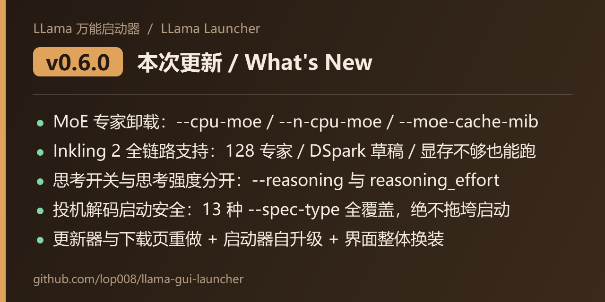
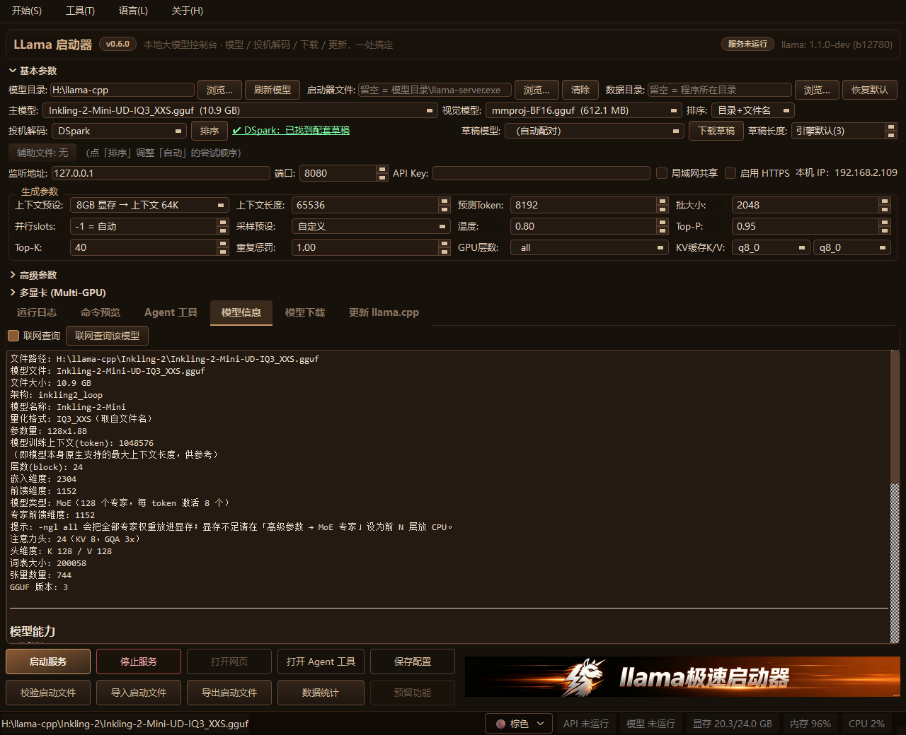
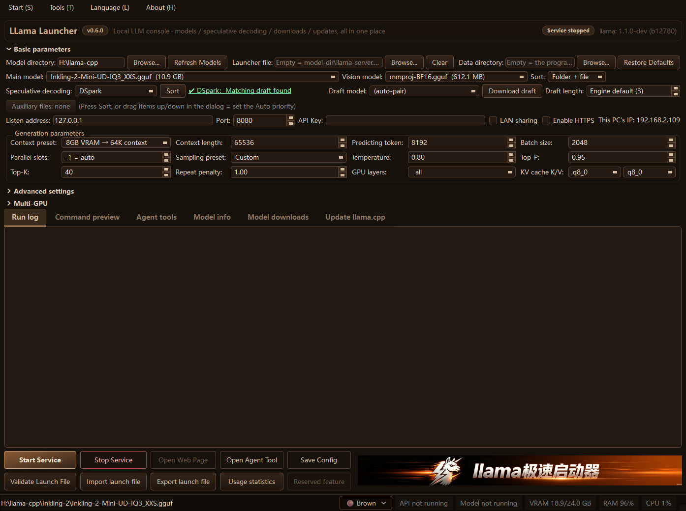

[](https://raw.githubusercontent.com/lop008/llama-gui-launcher/main/docs/cover-v0.6.0.png)

## LLama 万能启动器 v0.6.0

基于 llama.cpp 的本地大模型图形化启动器。自动扫描模型、可视化调参、隐藏窗口后台运行、实时监控、一键连接 Agent 工具。

A GUI launcher for llama.cpp local LLMs. Auto-scan models, visual parameter tuning, hidden-window background startup, real-time monitoring, one-click Agent tool connection.

> 本版把 **llama.cpp 最新的一批参数搬进了界面**：MoE 专家卸载、思考开关与思考强度分离、投机解码 13 种 `--spec-type` 全覆盖；**Inkling 2（MoE）全链路支持**并给出配置指引；「更新 llama.cpp」与「模型下载」两页重做；启动器支持自升级；界面整体换装。
> This release brings llama.cpp's newest switches into the UI: MoE expert offloading, thinking on/off separated from reasoning effort, and all 13 `--spec-type` values handled safely. Inkling 2 (MoE) is supported end to end with a setup guide, the llama.cpp updater and the download page were rebuilt, the launcher can update itself, and the whole interface was restyled.

### 本次更新 / What's New in v0.6.0

- ⚡ **投机解码再也不会把服务搞崩 / launch-safe speculative decoding** — 明确选中的方式必须「本机 `llama-server` 认识这个取值」且「草稿与主模型真配套」才下发，否则**完全不带 `--spec-type`**、服务照常启动并在状态栏说明原因。当前构建的 **13 种取值**全覆盖：`none` / `draft-mtp` / `draft-dflash` / `draft-dflash2` / `draft-dspark` / `draft-lilicorr` / `draft-eagle3` / `draft-simple` / `ngram-mod` / `ngram-cache` / `ngram-simple` / `ngram-map-k` / `ngram-map-k4v`。此前保存过 `mtp` 但模型没有 MTP 头会直接 `failed to create MTP context`，现在不会再发生。
- 🧠 **草稿配对改成真配对 / real draft matching** — 比较词表大小、`embedding_length` 与**架构族**：DSpark / DFlash / LiliCorr（架构族 `dflash`）与外挂 `xxx-mtp` 头不再被误判「架构不一致」；多分片主模型跨全部分片扫描内嵌 MTP 头；`ngram-simple` / `ngram-map-k4v` 不再误报缺草稿。草稿下拉在任何方式下都可用，逐项标注类型 / 大小 / 是否配套。
- 🧮 **MoE 专家卸载（新参数进界面）/ MoE expert offloading** — 高级参数新增「MoE 专家」行：`--cpu-moe`（全部专家放 CPU）、`--n-cpu-moe N`（**前 N 层专家放 CPU**，MoE 最常用）、`--moe-cache-mib N`（CPU 专家的 GPU 缓存）。这是 `-ngl all` 把 MoE 全部专家塞进显存的唯一解，稠密模型不受影响。
- 🦄 **Inkling 2 支持 / Inkling 2 support** — `inkling2_loop` 识别为 MoE（**128 个专家、每 token 激活 8 个**、上下文 1 048 576），同目录 `dspark-*` 草稿自动配对，排序 `Q8_0` > `BF16` > `*_Old` 旧转换件。配置见下方「Inkling 2 快速配置」。
- 💭 **思考开关 ≠ 思考强度 / thinking vs. reasoning effort** — 「思考模式」下发 `--reasoning on/off/auto`；「思考强度」下发 `--chat-template-kwargs {"reasoning_effort":…}`，**只有模型 Jinja 模板真的声明了 `reasoning_effort` 才启用**，选项按模板实际取值重建（Inkling：`minimal/low/medium/high/xhigh/max`；Qwen3-0.6B、Gemma 4 只有开关）。旧配置里残留的 `medium` 会被清掉，不再下发给不支持的模型。
- 🔄 **「更新 llama.cpp」页重做 / updater rebuilt** — 统计卡（当前版本按 `1.1.0-dev (b12780)` 显示、最新稳定版、磁盘上已下载的包）、**可见的分段筛选**（全部 / 仅稳定 / 仅预发布 / 仅已下载 / 仅有 Windows 包）、行复选框 + 全选 + 下载选中、递归扫描下载目录。没发 Windows 二进制包的 Release（`v1.1.0` 只有 `nightly-tag.txt`）保留一行标注「无 Windows 包」并给 Release 链接，不再整条消失。
- 📥 **「模型下载」页重做 / download page rebuilt** — 组织/作者改成**可输入 + 常用作者下拉**（默认 `unsloth`，预置 `ggml-org` / `bartowski` / `Qwen` 等）；文件列表改成**目录树**，勾选文件夹 = 整组下载（4 分片模型一次搞定）；仓库信息追加目录清单与可点击的 `huggingface.co/<仓库>` 链接。
- 📋 **模型信息增强 / richer model info** — 显示「模型类型：MoE（N 个专家，每 token 激活 M 个）/ 稠密」、「思考能力」（只有开关 / 支持哪些档位）、「投机解码支持」（每种方式的状态、原因、草稿路径），并附可点击的模型主页与 HuggingFace 搜索链接。
- 🛠 **Agent 工具可增删改 / Agent tool management** — 列顺序改成 工具 / 类型 / **路径** / 描述 / 打开（路径移到描述左侧、「打开」列收窄），新增添加、编辑、删除（内置工具只隐藏不删文件），描述可从 exe 的 `FileDescription` / `ProductName` 自动读取。
- 🚀 **启动器自升级 / self-update** — 菜单「关于 → 检查启动器更新…」按本机架构下载新版 exe，退出后自动备份、替换并重启；源码运行只打开 Release 页面。启动时的静默检查只在标题栏/状态栏提示，可在高级参数关闭。
- 🎨 **界面整体升级 / UI overhaul** — 新增卡片、分段控件、状态徽章、统计块、空状态组件；单选按钮终于有可见选中态，按钮新增 primary / danger / ghost / segment 变体，表格、页签、进度条、下拉框、分栏、菜单统一现代样式；顶部标题卡显示版本、服务状态与检测到的 llama.cpp 版本。
- 🌍 **语言表与源码严格对齐 / i18n kept exhaustive** — 本版新增 165 条界面文案全部译入 7 张语言表（繁中 / 英 / 日 / 韩 / 俄 / 西 / 法），并清理改版后失效的旧条目：**959 个 key，缺失 0、多余 0**，占位符 / 换行 / HTML 标签逐条校验。
- 🐛 **修复：打包版语言设置被无声忽略** — `main.py` 按 `__file__` 找 `config.json`，而 PyInstaller 6 的入口脚本在只读的 `_internal\` 里、用户配置在 exe 同级目录，导致打包版永远读不到 `language` 而固定跟随系统语言。现在冻结态按 `sys.executable` 定位，与主窗口同一规则。
- 🐛 **其他修复** — 更新器 `include_prerelease=False` 误用资产过滤参数；`tag` / `tag_name` 两种字段都兼容；模型 / 仓库链接改用 `QTextBrowser` 后可点击；启动静默检查在窗口已关闭时不再报错；更新页翻页按 tag 去重。

### Inkling 2 快速配置 / Quick setup

1. **先更新 llama.cpp**：Inkling 2 需要 **b12780 及以后**。到「更新 llama.cpp」页选 `b12780` 或更高 nightly 安装（`v1.1.0` 那个 tag 没有 Windows 包，页面会标出来，别选它）。
2. **草稿与主模型放同一目录**（草稿必须同目录才会配对）：

   ```
   H:\llama-cpp\Inkling-2\
   ├─ Inkling-2-Mini-UD-IQ3_XXS.gguf        ← 主模型
   └─ dspark-Inkling-2-Mini-Q8_0.gguf       ← DSpark 草稿（优先 Q8_0）
   ```

3. **基本页**：选中主模型 → 投机解码选 `DSpark`（状态显示「✔ 已找到配套草稿」），草稿下拉自动选中 Q8_0；勾上 **Jinja 模板**，思考模式 `auto`，思考强度 `medium`。
4. **高级参数 → MoE 专家**（决定显存够不够）：显存充裕选「不额外处理」；被别的模型占掉一半选「**前 N 层放 CPU**」，N 从 **8** 起，不够就 12 / 16 / 24；几乎没显存选「全部放 CPU」。用 `--n-cpu-moe` 后速度明显下降时，把「专家缓存(MiB)」设 512~2048。
5. 实际下发的命令（「命令预览」可核对）：

   ```bat
   llama-server.exe -m Inkling-2-Mini-UD-IQ3_XXS.gguf ^
     --spec-type draft-dspark --spec-draft-model dspark-Inkling-2-Mini-Q8_0.gguf ^
     -ngl all --n-cpu-moe 12 --moe-cache-mib 1024 ^
     -c 32768 --jinja --reasoning auto ^
     --chat-template-kwargs "{\"reasoning_effort\":\"medium\"}" --port 8080 --metrics
   ```

   还是起不来就按顺序试：上下文降到 8192 → `--n-cpu-moe` 加大 → 关掉投机解码排除草稿因素。完整说明见仓库 `参数说明.md` 的「八、Inkling 2（MoE）配置指引」。

### 主要功能 / Features

- 投机解码：13 种 `--spec-type` + 自动 + 优先级排序 + 草稿模型一键获取 + 启动安全兜底
- MoE 专家卸载：`--cpu-moe` / `--n-cpu-moe` / `--moe-cache-mib`（Inkling 这类 MoE 模型的显存救星）
- 思考模式（`--reasoning`）与思考强度（`reasoning_effort`）分开控制，按模型模板实测能力
- 8 种语言界面 + 跟随系统语言 + 切换记忆
- 自动扫描模型 + 视觉模型按目录配对 + 辅助文件角色筛查与清单
- 可视化参数配置（上下文/采样预设联动、KV 量化、多显卡、Flash Attention）
- 隐藏窗口后台启动，`/health` 就绪自动打开浏览器；崩溃防残留（Windows 作业对象，显存自动释放）
- 实时状态栏监控（CPU / 内存 / 显存 / 模型 / API 活动）+ 托盘悬浮小窗（实时 tok/s）
- HTTPS 自签名证书 + 局域网共享；Agent 工具自动连接与增删改
- 模型下载（HuggingFace 目录树整组下载、断点续传）与 llama.cpp 在线更新（x64 与 arm64 都列出）
- 启动器自升级 / 托盘最小化 / 日志落盘 / 六套主题 / 导出导入配置(.aic)

### 截图 / Screenshots

主界面（顶部标题卡 + 投机解码行显示 DSpark 已配套）/ Main page:

[](https://raw.githubusercontent.com/lop008/llama-gui-launcher/main/docs/screenshots/main.png)

高级参数（新增「MoE 专家」行、思考模式与思考强度、启动时检查更新）/ Advanced page with the new MoE experts row:

[](https://raw.githubusercontent.com/lop008/llama-gui-launcher/main/docs/screenshots/advanced.png)

模型信息（MoE 事实 / 思考能力 / 投机解码支持表）/ Model info with MoE facts and the speculative-decoding support table:

[](https://raw.githubusercontent.com/lop008/llama-gui-launcher/main/docs/screenshots/model_info.png)

更新 llama.cpp（统计卡 + 分段筛选 + 复选框批量下载 + 「无 Windows 包」标注）/ Rebuilt updater:

[](https://raw.githubusercontent.com/lop008/llama-gui-launcher/main/docs/screenshots/updater.png)

模型下载（常用作者下拉 + 目录树整组勾选）/ Download page with folder tree:

[](https://raw.githubusercontent.com/lop008/llama-gui-launcher/main/docs/screenshots/download.png)

更多界面 / More（棕色主题 / brown theme）:

[](https://raw.githubusercontent.com/lop008/llama-gui-launcher/main/docs/screenshots/main_en.png)
[](https://raw.githubusercontent.com/lop008/llama-gui-launcher/main/docs/screenshots/agent.png)
[](https://raw.githubusercontent.com/lop008/llama-gui-launcher/main/docs/screenshots/preview.png)

### 下载 / Downloads

| 文件 | 说明 |
|------|------|
| `LLama-Launcher-v0.6.0-win-x64.exe` | 单文件版（x64），无需安装 Python，双击即用 |
| `LLama-Launcher-v0.6.0-win-x64-portable.zip` | 便携版（x64），解压即用 |
| `LLama-Launcher-v0.6.0-win-arm64.exe` | 单文件版（ARM64，骁龙笔记本 / Windows on ARM） |
| `LLama-Launcher-v0.6.0-win-arm64-portable.zip` | 便携版（ARM64），解压即用 |
| `Arm64.bat` | ARM64 一键启动脚本：与 exe 同目录双击即可，永远优先挑 arm64 包（`一键启动.bat` 优先 x64） |
| Source code (zip / tar.gz) | 源码 |

> ARM64 用户仍需自行安装 arm64 版 llama.cpp（官方每个版本都发 `-bin-win-cpu-arm64` / `-vulkan-arm64` / `-opencl-adreno-arm64` / `cuda-*-arm64`），更新器能直接看到并下载它们。

### 关于 / About

开发者：AI创客师 · License: MIT
