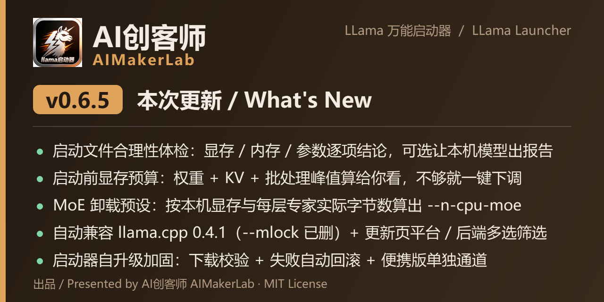
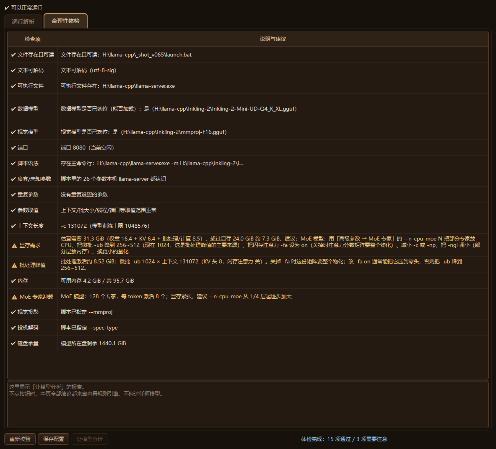

## LLama 万能启动器 v0.6.5

基于 llama.cpp 的本地大模型图形化启动器。自动扫描模型、可视化调参、隐藏窗口后台运行、实时监控、一键连接 Agent 工具。

A GUI launcher for llama.cpp local LLMs. Auto-scan models, visual parameter tuning, hidden-window background startup, real-time monitoring, one-click Agent tool connection.

> 本版把 **v0.6.1 – v0.6.4（四个未单独发布的内部迭代）合并成一个正式版本**，核心是一件事：**启动前先按你这台机器算一遍，算不通就别让服务起不来。**
> This release folds four unpublished internal iterations (v0.6.1 – v0.6.4) into one. The theme: **compute against your actual machine before launching, and never let a wrong flag kill the server.**

### 本次更新 / What's New in v0.6.5

- 🩺 **启动文件合理性体检 / Launch-script sanity check** — 「工具 → 启动文件 → 校验启动文件」新增第二页签，**完全离线**按本机逐项给结论：废弃 / 未知参数、重复设置、取值越界（线程数 vs 逻辑核心、`-ub` vs `-b`、端口）、上下文 vs 模型训练上限，以及显存（权重 + KV + 计算缓存）/ 内存 / 磁盘估算。读不到的元数据只写「读不到」，绝不编数字。 *A second tab validates the script against this real machine, offline.*
- 🤖 **「让模型分析」——不点就绝不调用模型 / Opt-in model report** — 一个按钮把体检数据（机器配置 + 模型元数据 + 参数，**API Key 已打码**）交给**本机正在运行**的 llama-server 出报告；服务未运行时按钮置灰，全程不碰任何外部服务，调用失败时上方内置结论依然有效。
- 📊 **启动前显存预算 + 微批 `-ub` / Pre-launch VRAM budget & micro-batch** — 以前启动器从不下发 `-ub`，而它恰恰决定一次有多少 token 进 GPU；现在它有独立输入框。点「启动服务」时按 **权重 + KV + 批处理激活缓冲** 与**当前真实可用显存**比对，不够就把数字摆出来，给你「按建议微批启动 / 仍然启动 / 取消」——不静默改设置，读不到显存就不弹窗。批处理项由 15 次实测 llama-server 自报缓冲得到（最大偏差 3.7%，取值偏保守）。
- 🧩 **MoE 卸载预设：算出来的，不是查表的 / Computed MoE offload presets** — 高级参数里选目标档位（自动 / 全进显存 / 均衡 / 省显存 / 极限 / 长上下文），启动器按本机显存与内存 + **这个模型每层专家的实际字节数**当场算出 `--n-cpu-moe N` 与 `--moe-cache-mib`，并把计算过程写在下一行。同一张 24 GiB 卡：Inkling 2（专家 14.7 GiB）要 N=0，Flash-Next（71.7 GiB）要 `--cpu-moe`——所以不做「显存档位 × 内存档位」静态表；又因为 `--n-cpu-moe` 卸的是**前 N 层**而动态量化让上层每层更重（Inkling 2：21 层 547 MiB + 3 层 1033 MiB），拟合是从上往下搜而不是按层数平摊。稠密模型整套置灰**且命令行不再下发**这三个参数。
- 🔌 **新版 llama.cpp 不再把服务搞崩 / Survives llama.cpp 0.4.1** — 0.4.1（2026-09）删掉 `--mlock` / `--mmap` / `--no-mmap` / `--direct-io`，合并为 `-lm/--load-mode`；照旧写死的脚本会以 `error: invalid argument` 起不来。启动器改为读本机 `llama-server --help`（按 exe 缓存、启动后后台预热）：**新版发** `-lm mmap+mlock` / `-lm none` / `-lm mlock`，**旧版仍发**老参数；导入 `.bat` 也能把 `-lm` 读回勾选框。
- 📥 **更新页筛选真的会筛 / Updater filters that actually filter** — 「仅 Windows 包」勾选 + 后端多选（CPU / CUDA / Vulkan / ROCm / SYCL / OpenVINO / OpenCL / zDNN，只列加载结果里真实出现过的）；同一维度多选是 OR、不同维度是 AND、不选即不限。「仅显示已下载」只认磁盘上确实存在的文件；非本机架构的包仍可下载但安装按钮禁用并写明原因；新增「打开 llama.cpp 下载页」。
- ⬆️ **启动器自升级加固 / Self-update hardened** — 「关于 → 检查启动器更新…」+ 启动 6 秒后的静默检查（只亮标题栏徽章，不弹窗）。原先的替换脚本是三条 `move` 且不判错误：新下的未签名 exe 被杀毒吃掉时，正在用的 exe 已被改名 `.bak`，脚本还会去启动一个不存在的文件（本机用真脚本复现过）。现在每一步判 `errorlevel`、失败自动回滚、可能不存在的文件绝不启动、原因在下次启动时用状态栏说明一次；下载要比对 GitHub 报告的资产大小并通过 `MZ` / zip 文件头校验，`.part` 记录来源 URL 防止把两个版本拼成一个，开始前检查磁盘空间。**便携版（exe + `_internal`）走 `-portable.zip`**：依赖一起换，`config.json`、`logs/`、`stats.json` 原样不动；某版本只有一种包时对话框直接说明，不再偷偷换。
- 🔮 **投机解码与视觉投影更稳 / Speculative decoding & vision projectors** — 本机 `llama-server` 不认、或主模型没有对应结构且本机无可用草稿的方式**置灰不可选**并写明原因（「能用但还缺一个草稿」保留可选并标 `⚠`）；保存过但不适合当前模型的方式回落 Auto，并在状态栏说明一次——界面与命令行共用同一判据，不会各说各话。视觉投影按精度配对 **F16 > BF16 > F32 > 量化**（多模态模型上 F32 投影约多占一倍内存），留空而模型带 mmproj 时给提示。
- 🔤 **界面可用性与崩溃加固 / UI usability & crash hardening** — 整体字号 `Ctrl` + 滚轮或 `Ctrl` `+` / `-` / `0` 在 80%–180% 缩放并记住（写死像素的行高、图标、边距一起缩放，换主题不丢，`Ctrl+0` 复位）；表格每一列都能手动拖宽（拖过之后不再永久停止补宽）、路径列**从中间省略**保住文件名、操作列按按钮实测定宽（任何语言都不裁字）；预测 Token 与批大小改成**可选可输**下拉；运行日志页新增「清屏」「打开日志目录」（只影响显示，磁盘日志不动）并限制内存 5000 行；命令预览改两栏可拖（逐参数「参数 / 作用」拆解 + 原始命令行，拆解只读最终命令，与实跑一致）；修掉反复重建窗口时 `QComboBox.setItemText()` 的原生崩溃（`0xC0000005`）与后台回调落到正在销毁的窗口。
- 🌍 **7 张语言表逐条对齐 / All 7 language tables in step** — 四批反馈共 **259 条**新增界面文案全部译入繁中 / 英 / 日 / 韩 / 俄 / 西 / 法，并清掉改版失效的 19 条：**每张表 1199 条，缺失 0、多余 0**，占位符 / 换行 / HTML 标签逐条校验。

### 主要功能 / Features

- 自动扫描模型 + 视觉投影按目录配对 + 维度一致性校验；模型信息页直出 MoE / 思考能力 / 投机解码支持
- 可视化调参（上下文与显存档位联动、采样预设、KV 量化、多显卡、Flash Attention、MoE 专家卸载、投机解码）
- 隐藏命令行窗口后台启动，`/health` 就绪自动打开浏览器；崩溃防残留（Windows 作业对象，显存自动释放）
- 实时状态栏监控（CPU / 内存 / 显存 / 各显卡 / API 活动 / 生成速度）+ 托盘悬浮小窗 + 使用统计
- 模型下载（HuggingFace，可按目录整组勾选，断点续传）与 llama.cpp 在线更新（平台 / 后端筛选）
- Agent 工具一键连接（opencode / 自定义工具，增删改 + 自动生成配置）
- 六套主题、界面字号缩放、导出导入配置、启动文件导出 / 导入 / 校验 / 合理性体检、启动器自升级
- 多语言界面：简体中文 / 繁中 / English / 日本語 / 한국어 / Русский / Español / Français（可跟随系统语言）

### 截图 / Screenshots

| 主界面 Main window | 合理性体检 Sanity check |
|---|---|
|  |  |

### 下载 / Downloads

| 文件 | 说明 |
|------|------|
| `LLama-Launcher-v0.6.5-win-x64.exe` | 单文件版（x64），无需安装 Python，双击即用 |
| `LLama-Launcher-v0.6.5-win-x64-portable.zip` | 便携版（x64），解压即用 |
| `LLama-Launcher-v0.6.5-win-arm64.exe` | 单文件版（ARM64，骁龙本 / Windows on ARM） |
| `LLama-Launcher-v0.6.5-win-arm64-portable.zip` | 便携版（ARM64），解压即用 |
| `Arm64.bat` | ARM64 一键启动脚本，与 exe 同目录双击即可（优先 arm64） |

> 已装 v0.6.0 的用户不用手动下载：升级后「关于 → 检查启动器更新…」即可自升级，单文件版与便携版各走各的包。
> Already on v0.6.0? *About → Check for launcher updates* handles both the single-file and the portable install.

### 关于 / About

- 开发者 / Developer：**AI创客师** · AIMakerLab
- License: MIT
